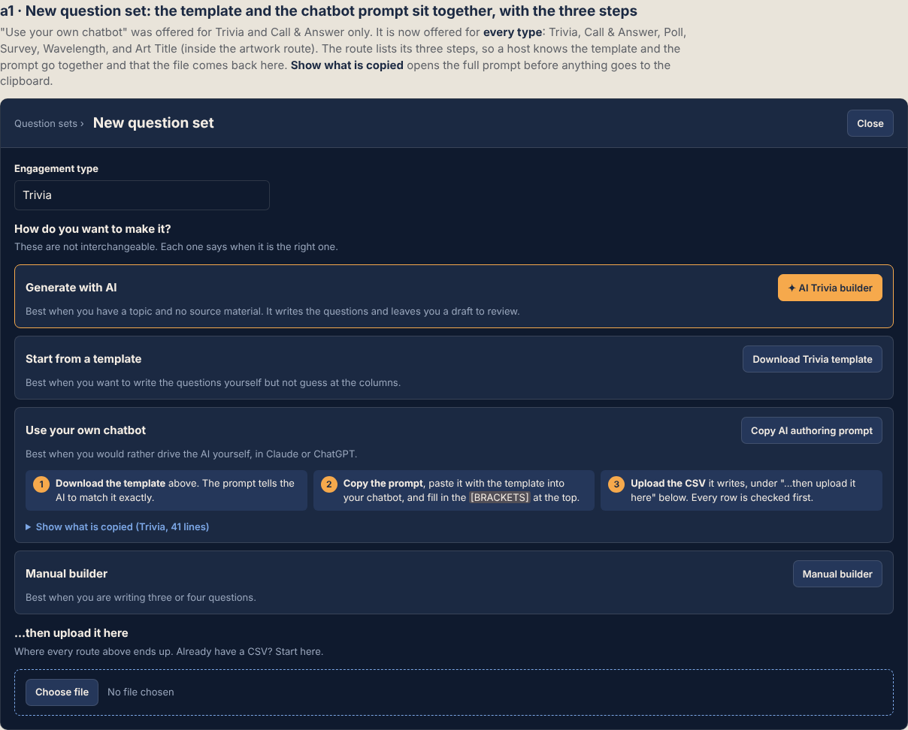
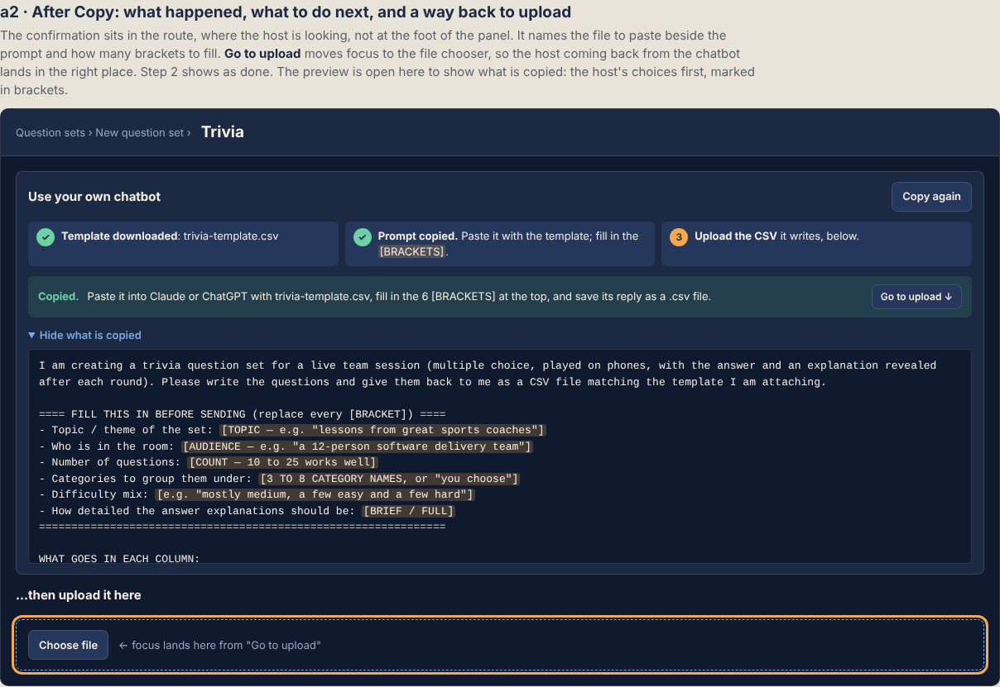
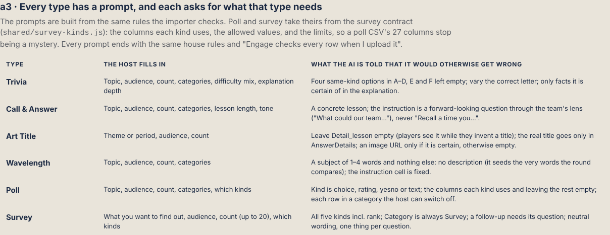
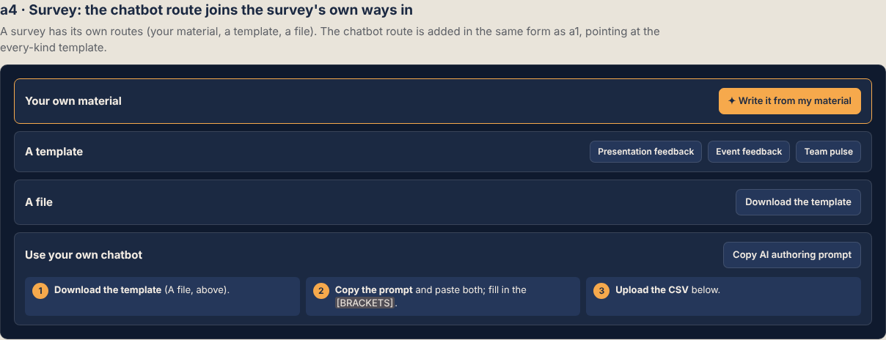
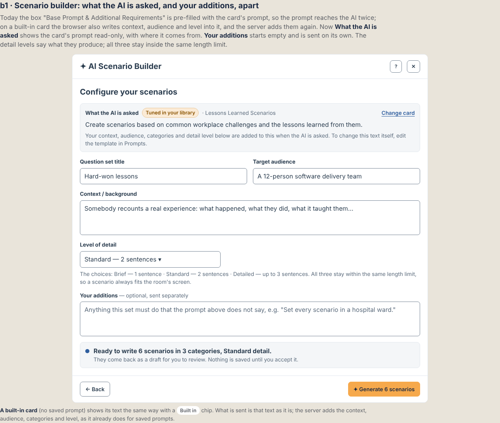
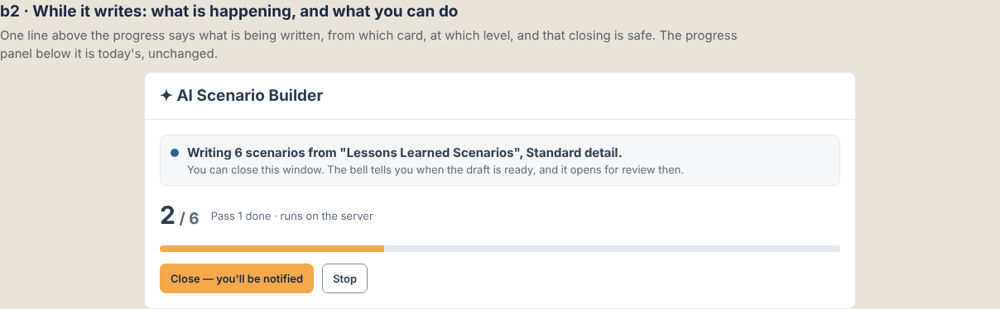
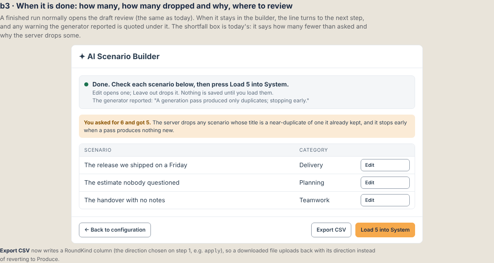

# Authoring guidance: templates, AI prompts and the scenario builder (mockup, 25 Oct 2026)

The owner, offline, approving this work:

> "any major UI change please doc a mockup and use that as guidance… really focus on
> usability and ease of use, clear visuals for host and the players and the room window…
> Keep them informed of what is happening and what they can or should do next and ability
> to easily see what has been created and communicate."

`index.html` is the mockup the build follows. Open it directly; `?theme=dark` switches the
page shell (the frames keep their own surfaces, as the product does: the question-sets panel
is dusk in the console, the AI builder modal is white). The PNGs beside it are renders of
each frame, light and dark shell.

## What changes, and why

An audit of the question-set templates found three things that taught AIs the wrong lesson,
because agents copy examples before they read rules:

| Found | Where | Fix |
|---|---|---|
| Every trivia row was correct on **OptionA**, with six options, two of them jokes ("To lift heavy objects") | `download-template.js` trivia rows | The correct letter rotates (A, C, B); A–D are four same-kind options; E and F are empty; one row shows the optional Background column |
| Call & Answer instructions were personal ("How would you apply… in your current team") and the lessons were "greatest of all time" boilerplate | `download-template.js` call-and-answer rows | Three real practices (blameless review, stop the line, disagree and commit), each with a forward-looking, team-lens question |
| Wavelength rows carried a framing sentence, which the generator strips because it seeds the words the round compares | `download-template.js` wavelength rows | Subject only; Detail_lesson empty |
| "Copy AI authoring prompt" existed for Trivia and Call & Answer only; a poll or survey CSV has 27 columns and no explanation | `config/aiAuthoringPrompt.js` | A prompt for every type. Poll and survey prompts are built from the survey contract (`shared/survey-kinds.js`), mirrored into `src/src/config/surveyContract.json` by `scripts/build-survey-contract.js` |
| The scenario builder pre-filled "Base Prompt & Additional Requirements" with the card's prompt, so it reached the AI twice; for a built-in card the browser also composed context, audience and level into `prompt` and the server added them again | `AIScenarioBuilder.jsx` | `prompt` is the card's text as it is; `customPrompt` is only what the host typed; the card's text is shown read-only |
| "Comprehensive" detail contradicted the hard length cap | `AIScenarioBuilder.jsx` | Brief — 1 sentence / Standard — 2 sentences / Detailed — up to 3 sentences. Labels only; the values sent (`brief`, `detailed`, `comprehensive`) are unchanged |
| Export CSV dropped the round kind, so a downloaded set uploaded back as Produce | `AIScenarioBuilder.jsx`, `shared/generated-set.js` | A RoundKind column per row when a direction applies |

## The frames

| Frame | What it shows | Render |
|---|---|---|
| a1 | New question set, Trivia: template and chatbot routes together, the chatbot route's three steps, "Show what is copied" |  |
| a2 | After Copy: the confirmation in the route, the steps ticked, the prompt preview open, "Go to upload" moving focus to the file chooser |  |
| a3 | What each type's prompt asks the host to fill in, and what it tells the AI |  |
| a4 | Survey: the chatbot route joins the survey's own routes |  |
| b1 | Scenario builder: "What the AI is asked" (read-only), "Your additions" (empty), relabelled detail level, a ready line |  |
| b2 | While it writes: one line saying what, from which card, at which level, and that closing is safe |  |
| b3 | When it stays in the builder: the next step, the generator's own warnings quoted, today's shortfall box |  |

## Decisions

- **The confirmation goes where the host is looking.** The panel's status line sits at its
  foot; a host who pressed Copy in the middle of the route list would not see it. The route
  carries its own "Copied" line and a "Go to upload" button that focuses the file chooser.
- **The prompt is previewable before it is copied.** A host should see what they are handing
  to another AI. The preview is a `
`, shut by default.
- **The level control stays a select.** Relabelled, with a help line naming all three. A new
  control would be a redesign this work does not need.
- **No new count in b3.** The shortfall ("You asked for 6 and got 5") is already stated by
  `GeneratedItemsTable`; the run line says the next step and quotes the generator's warnings
  instead of repeating the number (one fact, one place).
- **A finished run still hands off to the draft review.** b3 is the path where it does not
  (no draft id, e.g. an older job). The draft review screen is unchanged.

## Not in this work

The generation backend (`ai-generate-*.js`, `structured-generation.js`) and Workie's rules are
being changed by other sessions. The builder's change works with or without the server
dropping an exact duplicate of the base prompt, because it no longer sends one.
