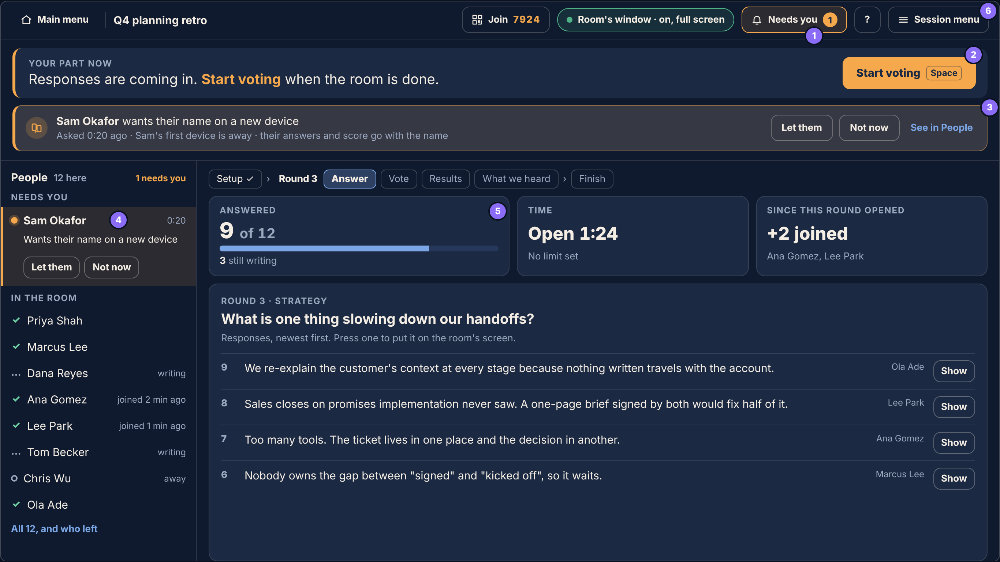
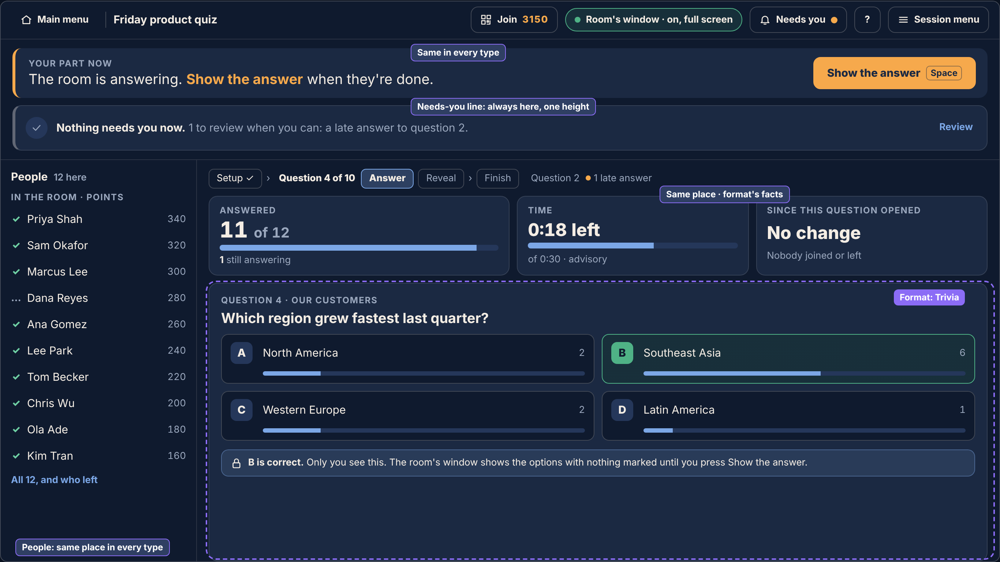
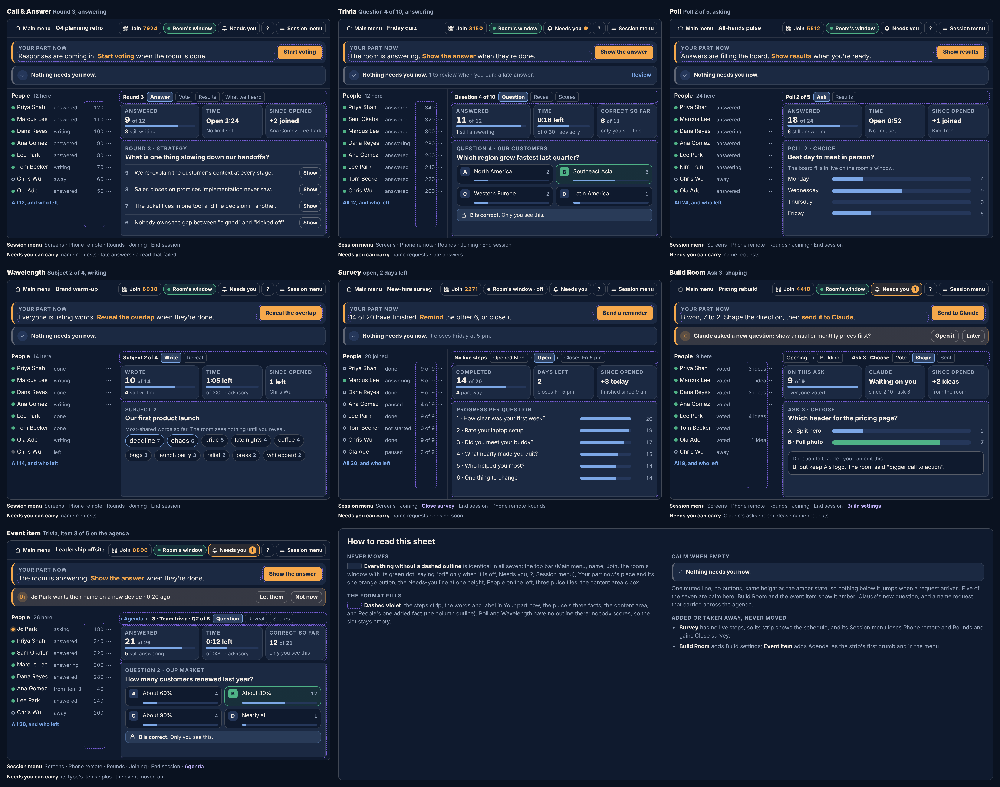
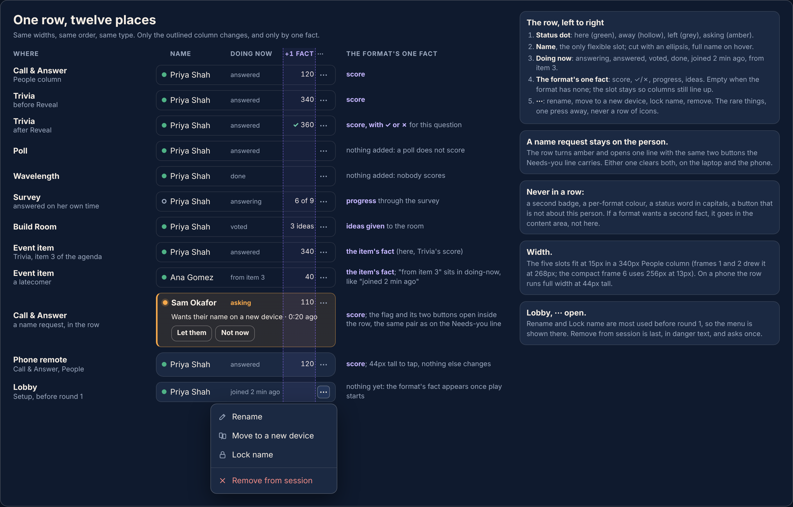
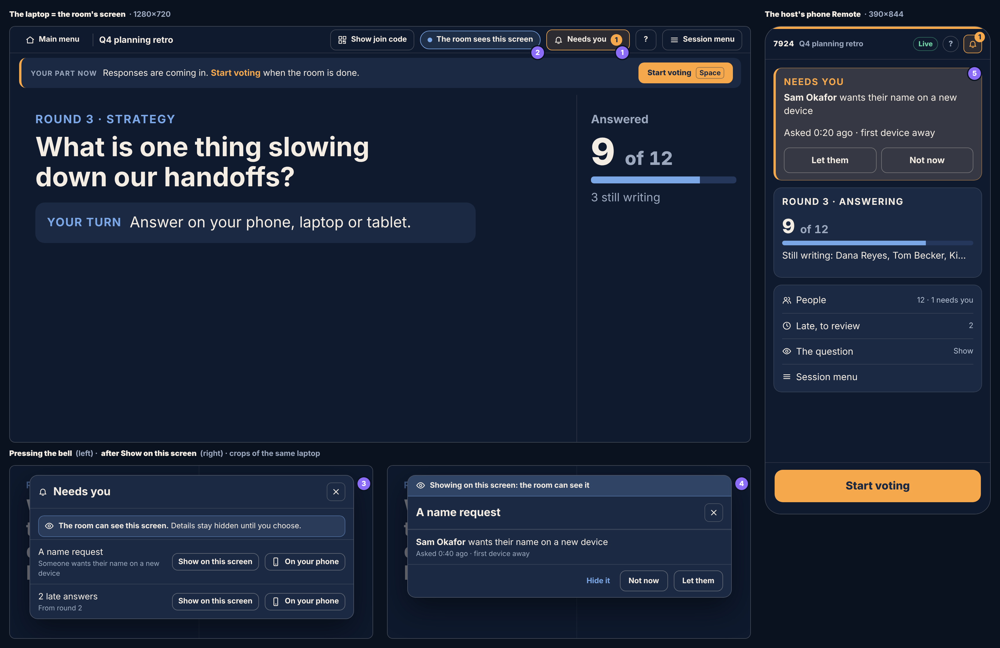
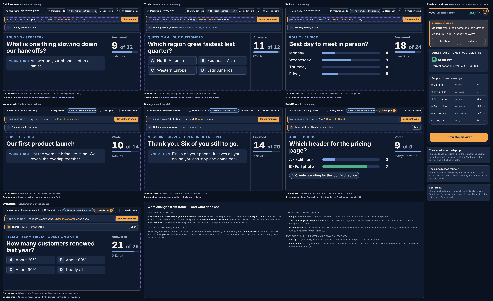
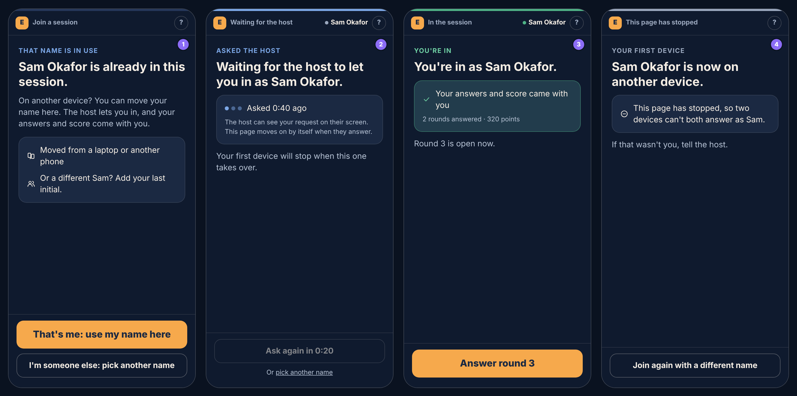
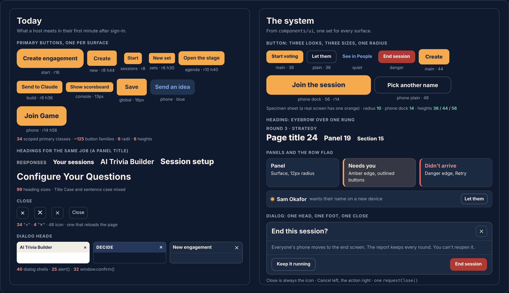

# The experience plan: one Engage, organised end to end

*1 Nov 2026, revision 2 (after the desk reviews in `reviews.md`). Written for the owner.
Mockups: `index.html` in this folder, rendered as `p-*.png`. Evidence is in the five audits in
`audit/` and is cited in the footnotes, so the body can stay in plain words. No application
code has changed.*

> The owner, 1 Nov: *"how can we step back and really organize the end to end experience and
> then fix the UX to match that. its a big ask but we have 99% of the functionality, just not
> organized for a simple and visually appealing experience."*

The audits agree with the 99%. Almost nothing in this plan is a new feature. It is a set of
places, names and rules, and a phased move of what already exists into them.

---

## 1. The diagnosis in one page

**What went wrong.** Each feature was built on the screen where it was first needed, to that
screen's local habits, and then copied (or not) to the others. The Build Room got a named
request strip; Call & Answer never did. The phone Remote got the read; it never got the
buttons to act on it. The one-screen stage got a failed-read card with Retry; the two-screen
console did not. Every one of those was a sensible local decision. Together they are a
product that changes shape under the host's hand.

**Why it kept happening.** The rules were written down, more than once, and nothing checked
them. A plan from 12 Oct specified the exact name-request strip the owner went looking for;
it was never built and no test noticed.[^1] The host standards (16 Oct) say "where the
laptop is the room's screen, everything on it is public"; the Session panel still draws
private warnings over the projected stage.[^2] The 8 Oct review ruled "Main menu" as the one
word for leaving; there are now seven.[^3] A shared button library was built and palette
tested; one page uses it.[^4] Rules that live only in documents drift. Rules that live in
tests hold (the colour ratchet and the still-dock test are the two that did).

**The six most telling examples**

| # | What the host or participant meets | Why it matters |
|---|---|---|
| 1 | **The takeover.** A person asking for their name shows up in exactly one place: a tinted row, in score order, inside the Players tab of the right-hand Session panel. Not the People list, not the bell, not the lobby, not the phone Remote. The help says "SESSION on the dock shows a count"; on Call & Answer there is no count and, on two screens, no dock.[^5] The asker's phone is never told the answer, and their old device keeps playing.[^6] | A person is stuck and the host cannot see them. |
| 2 | **Three laptop layouts for one type.** Call & Answer on two screens gets the console; the same type inside an event gets the projector layout on the private laptop; on one screen it gets the stage. Trivia, Poll and Wavelength can never get two screens, though the code lists them as if they could. The Build Room has a fourth layout.[^7] | Everything the host learnt moves when the mode or type changes. |
| 3 | **Seven labels for leave.** Back to Menu, Back to menu, ← All sessions (which goes to the start screen, not a sessions list), Main menu, ← Main screen, Back to the agenda, Back to the console. In four positions.[^3] | The most basic act has no name. |
| 4 | **34 primary-button styles.** Six corner radii and six heights on buttons a host presses in their first minute; ~125 button class families; 40 dialog shells; three different close glyphs.[^4] | "Buttons change from view to view", in numbers. |
| 5 | **A private panel on the public screen.** On one screen the laptop is what the room watches, and the Session panel opens over it: Workie's read-check warning (reproduced on test, #48), late answers with authors, a name request, Workie's settings, upcoming question titles.[^2] This hits every Trivia, Poll, Wavelength and Survey session, because those never get two screens. | The room reads what only the host should. |
| 6 | **Two homes.** The start screen and the console each have their own Sessions, Question sets, Reports and Events, built from different parts in different styles. "New" has four doors with four landings.[^8] | A host does not know where their things live. |

Smaller symptoms of the same cause: the bell is an account inbox polled every five minutes
and holds no session events at all; a failed Workie read is a blank card on the console with
the main button unlocked; the console's connection light is 12px text in a collapsed
section.[^9]

---

## 2. Principles

Eight rules. Each one is written so a test or a two-minute look on dev can say yes or no.

1. **One attention system.** Anything that needs the host becomes one item in one list,
   *Needs you*. That list shows in the same places in every mode and type: on the bell, on a
   Needs-you line under the main button (always there on a private laptop, amber when
   something is urgent, so nothing below it ever moves), and as a mark on the person or
   thing it concerns. *Test:* every event in the attention list has a tray line, a mark and
   a help line; a host page that does not mount the tray fails the build.
2. **One action, one name, one look, one place.** Leave is always *Main menu*, top left.
   Settings are always the *Session menu*, top right. Help is always `?`, beside it. The same
   words come from one words file. *Test:* a banned-words list ("Back to Menu", "All
   sessions", "Session setup", "big screen", "PRESENT") fails the build if any returns.
3. **The room's screen never shows host-private things.** Every piece of host UI is tagged
   *public*, *count only* or *private*. Where the laptop is the room's screen (one screen),
   public things draw, count-only things draw as a number with no names or text, and private
   things draw only on the host's phone, or on the laptop after a deliberate "Show on this
   screen: the room will see it" press for that one item. *Test:* render every host part
   with "the room sees this laptop" on; no private part may appear unrevealed.
4. **The main action is always in the same spot.** One bar, *Your part now*, directly under
   the top bar, in both screen modes and every type, with one orange button. *Test:* the
   frame's slot order is fixed and the existing still-dock test covers the bar.
5. **One live-session frame.** Every type, both modes, uses the same frame: top bar, Your
   part now, Needs you, People, the format's content area, the Session menu. *Test:* each
   host page renders the shared frame; a type cannot add chrome outside its content area.
6. **Format-specific UI only where the format needs it.** Of 41 per-type differences, 14
   are the format (what is asked, how it is answered, what is shown) and 27 are accidents of
   placement and naming.[^10] The 14 live inside the content area. The 27 go. *Test:* the
   frame's slots take words and data, not type-specific children.
7. **One component library.** Buttons, dialogs, headings, panels and the close glyph come
   from `components/ui`. *Test:* ratchets that fail when a new colour literal, a new
   primary-button class, a new `window.alert`/`confirm` or a text "×" close appears.
8. **The participant always knows what is next, and can do it from the dock.** Whatever a
   participant can do next sits in the dock at the bottom; every wait says what it is
   waiting for; every request they make gets an answer on their screen. *Test:* a phone
   screen with an action passes it to the dock; no primary button renders in the scrolling
   stage.

---

## 3. The experience architecture

### 3.1 The host's four places

| Place | What it is | One way in |
|---|---|---|
| **Home** | The start screen. New, Rejoin, today's and recent sessions, events. | The brand mark, and *Main menu* from anywhere. |
| **New** | One dialog (the shipped round-4 New engagement), with Quick start as its fast lane. Every format lands on its own Setup. | *New* on Home. |
| **Live session** | The one frame (§3.2). Starts at Setup, which is the lobby. | Start, or Rejoin. |
| **After** | The session's report, and the saved Reports list. | The end of the session; *Reports* on Home. |

The console (`/admin`) stops being a second home. It becomes **Library & team**: question
sets, saved reports, people, plan. Home shows the five most recent of each list and a "See
all" that opens the console's place for it, in place. One list per object, two frames, the
pattern the Reports list already follows.[^11]

### 3.2 The one live-session frame



```
┌ Main menu │ Session name │ Join 7924 │ Room's window ● on │ ⚑ Needs you 1 │ ? │ Session menu ┐  top bar
├──────────────────────────────────────────────────────────────────────────────────────────────┤
│ Your part now: "Start voting when the room is done."            [ Start voting · Space ]     │  main action
│ ▲ Sam wants their name on a new device · 0:20 ago     Let them  Not now  See in People       │  Needs-you line (always there; calm when empty)
├───────────────┬──────────────────────────────────────────────────────────────────────────────┤
│ PEOPLE · 12   │ pulse: answered 9 of 12 · open 1:24 · +2 joined                               │
│ ● Sam  asking │──────────────────────────────────────────────────────────────────────────────│
│ ✓ Priya       │ THE FORMAT'S CONTENT AREA                                                     │
│ … Marcus      │ (C&A: responses; Trivia: the question and the private answer; Poll: the live  │
│   …           │  board; Survey: progress per question; Build: the ask and Claude's status)    │
└───────────────┴──────────────────────────────────────────────────────────────────────────────┘
```

**What never moves** (every type, both modes): Main menu top left; the session's name; Join
code; the room's screen status; Needs you (the bell); `?`; Session menu top right; Your part
now under the top bar with its one orange button; the Needs-you line under that, at a fixed
height (calm when nothing is urgent, amber with buttons when something is); People on the left
on a private laptop.

**What the format supplies:** the content area, the words in Your part now (from its one
"what is the main button" function, which already exists per type[^12]), the pulse's facts,
and its own sections inside the Session menu.



### 3.2a One frame, every type (owner, 1 Nov: "only adding or subtracting items that apply")

Every live session, whatever its format, is the same frame. A format may only add or
subtract items in the slots below; it never moves a slot or restyles it.

| Slot | Call & Answer | Trivia | Poll | Wavelength | Survey | Build Room | Event item |
|---|---|---|---|---|---|---|---|
| Steps strip | Answer · Vote · Results · What we heard | Question · Reveal · Scores | Ask · Results | Write · Reveal | no live steps: the schedule instead (Opened · Open · Closes) | Opening · Building · then the ask's own: Vote · Shape · Sent | the item's own strip, with **‹ Agenda** as the first crumb |
| Your part now | the one main button | same | same | same | Close survey / Remind | Open the ask / Send to Claude | same as its type, plus "Back to agenda" when the item ends |
| Needs-you line | name requests, late items, failed read | name requests, late | name requests | name requests | name requests, closing soon | Claude's asks, room ideas, name requests | its type's, plus "the event moved on" |
| Pulse tiles | Answered · Time · Since opened | Answered · Time · Correct so far | Answered · Time · Since opened | Wrote · Time · Since opened | Completed · Days left · Since opened | On this ask · Claude · Since opened | its type's |
| Content area | responses | the question and the private answer | live board | words | progress per question | the ask and Claude's status | its type's |
| People column | ✓ | ✓ | ✓ | ✓ | ✓ | ✓ | ✓ (people carry across items) |
| Session menu | Screens · Phone remote · Rounds · Joining · End session | same | same | same | Screens · Joining · Close survey · End session (no Phone remote, no Rounds) | same + Build settings | same + Agenda |



Drawn in frame 6: the top bar, Your part now, the Needs-you line, the pulse tiles, People and
the Session menu button land in the same place in all seven; only the dashed slots change. The
Needs-you line is calm in five of them (one muted line, no buttons, the same height as the amber
state) and amber in two (Claude's new question in a Build Room; a name request carried across an
agenda). The top bar is literally identical in every format: an event adds **Agenda** as the
steps strip's first crumb and as a Session menu item, never as a top-bar button.

### 3.2b One person row, everywhere

A person looks the same in every list (People column, the full list, the phone remote, the
lobby, Setup): **status dot** (here / away / left) · **name** · **what they are doing now**
(writing, answered, voted, done) · **the Needs-you flag with its buttons, in the row itself** ·
a **⋯ menu** (rename, move to a new device, lock name, remove). Formats add one fact at the
end of the row and never anything else:

| Format | The one added fact |
|---|---|
| Call & Answer | score |
| Trivia | score, and ✓/✗ after Reveal |
| Poll | — |
| Wavelength | — (nobody scores) |
| Survey | progress, e.g. 6 of 9 |
| Build Room | ideas given |
| Event item | the item's fact (a latecomer shows "from item N" in the doing-now slot, the way anyone new shows "joined 2 min ago"; it is not a second fact) |

The slots have fixed widths in this order, so the columns line up in every list: status dot ·
name (the only flexible slot; ellipsis, full name on hover) · doing now · the added fact · ⋯.
When a format has no fact (Poll, Wavelength, the lobby before round 1) the slot stays empty
rather than collapsing. Trivia's ✓/✗ sits in front of the score in the same slot. The five
slots fit at 15px in a **340px** People column (frames 1 and 2 drew it at 268px, which is too
narrow for "joined 2 min ago" beside a score). On the phone remote the row is the same
component, full width and 44px tall to tap. A name request turns the row amber and opens one
line inside it with *Let them* / *Not now*, the same pair the Needs-you line carries; either
clears both. ⋯ holds Rename, Move to a new device, Lock name, then Remove from session in danger
text, confirmed.



**The Session menu** replaces the right-hand panel and its six names. It opens from one
labelled button, top right, as a sheet over the content area (never over Your part now). It
holds set-once settings: Screens, Your phone as a remote, The rounds, Joining, then End
session and Sign out at its foot. Anything you act on mid-round (name requests, late items,
a failed read, removing someone) moves out of it into Needs you or People, where it is
visible without opening anything.[^13]

### 3.3 One screen and two screens: only what the room sees differs

| | Two screens | One screen |
|---|---|---|
| The laptop | Private. The full frame. | Public: it *is* the room's screen. |
| What the room watches | The room's window (`/present`). | The frame's content area, large, plus a slim top bar and the slim Your part now. |
| Top bar | Main menu · name · Join · Room's window · Needs you · ? · Session menu. | The same slots in the same places; two words change: *Show join code* in Join's place, *The room sees this screen* in the room's-window place. |
| People column | Shown. | Hidden; the room's count shows in the content area as today. The list, with the same person row (§3.2b), is on the phone Remote. |
| Steps strip and pulse tiles | Shown. | Folded into the room's view: its eyebrow says where we are ("Round 3 · Strategy"), its meter is the count. Private tiles ("Correct so far") go to the phone. In an event, Agenda stays in the Session menu. |
| Needs you | Bell + the Needs-you line + marks, named. | Bell count only, never a name. Pressing it opens a sheet that starts with "The room can see this screen", lists items by kind ("A name request", "2 late answers"), and offers per item *Show on this screen* or *Open on your phone*. |
| Needs-you line | At its fixed height; calm, or amber with the named item and its buttons. | Still there, same height, same place, public-safe. Calm: the same muted line ("1 late answer to review, on your phone" for Soon items). When something waits: an amber edge but no amber wash, a count by kind and where to handle it ("1 name request · on your phone"), and one outlined *Open* that opens the bell's sheet. Never a name and never *Let them* / *Not now* on the room's screen. |
| Private detail (read-check, late text, Workie settings, the trivia answer, host notes) | In the frame. | On the phone Remote, or one item at a time after *Show on this screen*. |
| Main action | Your part now, under the top bar. | The same place, slim. Space and the clicker as today. |



(Frame 3 predates the public-safe Needs-you line and draws none; frame 8 is current.)

**One screen, every type** (owner, 1 Nov: "the same hold true from 1 screen host mode too?").
Yes: §3.2a holds in one-screen mode, with the subtractions above. Each format's content area
becomes its room view:

| Format | The room sees | Moves to the phone |
|---|---|---|
| Call & Answer | the question and the count; responses once voting opens | late answers, Workie's read and its Retry, who wrote what |
| Trivia | the options, nothing marked and no split, until *Show the answer* | the answer, correct so far, the split per option |
| Poll | the live board, as on the room's window | nothing extra |
| Wavelength | the subject and the count; no words until Reveal | the words as they come in |
| Survey | progress only, overall: how many finished, when it closes (per-question counts can point at a person in a small group) | progress per question, who has not finished |
| Build Room | the ask, the room's own vote, and one line of Claude's status | Claude's asks in full, the direction being shaped, ideas to let in |
| Event item | its type's room view | its type's items, plus Agenda |

People and the Session menu are on the phone in every format. Drawn at frame 6's type sizes;
the cells are 90px wider than frame 6's because the two longer top-bar labels need it at that
compact size (at a real 1280 laptop they fit, as frame 3 shows).



**What the phone Remote is for.** On one screen it is the host's private half: the Needs-you
list with its buttons, the trivia answer, the late list, Workie's read with Retry, host
notes, End session. On two screens it is a convenience: walk the room with the main button
in your hand. It reads the same Needs-you list as the laptop, so the two never disagree.[^14]

### 3.4 The participant's journey

Join (one code entry, the word "session" throughout) → name → lobby → for each round: answer,
vote, see your result, comment → end. One screen grammar on every type: the bar says where
you are ("Round 3 · Answer"), one eyebrow, one heading at one size, one card, and the action
in the dock. Moving to a new device is a first-class path (§4.3), not a dead end.[^15]

### 3.5 The room's screen

On two screens, the room's window follows the server and shows only what the room needs now.
On one screen, the content area is the room's screen and the host's chrome around it is kept
slim and public-safe by principle 3. Nothing about a name request, a late answer or a
Workie warning ever reaches either.

### 3.6 Names, once

| Say this | Not these (all in use today) | Meaning |
|---|---|---|
| **Main menu** (House icon) | Back to Menu, Back to menu, ← All sessions, ← Main screen, Back to the console | Leave this screen; the session keeps running. |
| **Agenda** | Back to the agenda | In an event, up one level. The first crumb of the steps strip (and an item in the Session menu); Main menu stays top left, and the top bar does not change. |
| **End session** | — (exists, but three levels deep) | Stop it for everyone. Session menu foot, confirmed. |
| **Session menu** | SESSION, Session setup, Session panel, Session tools, Settings, All settings | The one place for set-once settings. |
| **Needs you** | (nothing: today there is no name) | The list of things waiting on the host, behind the bell. |
| **People** | Players, All players, Joined so far, Players & rounds, Players N | Everyone in the session. |
| **The room's screen** | stage, wall, screen, big screen, projector, Presentation, PRESENT | Whatever the room watches. |
| **The room's window** | (ruled 22 Oct) | The separate browser window on two screens. |
| **Show join code / Hide join code** | Put the join code back on the stage, Display on screen, Show QR (J), Join 1234 | The one toggle, every surface, every phase. |
| **Your part now** | — | The main-action bar. |
| **Workie's read** | AI summary, the summary | Workie's write-up of a round. |
| **Session** | game, Game ID, Join Game, engagement (in running copy) | The thing a host runs and a participant joins. "New engagement" stays as the create dialog's name. |
| **Reports** / **Report** | Your reports, Session reports, All session reports, Results | Saved PDFs / one session's report. |
| **Comment on this round**, **Reply to this response** | Feedback (participant side), Comment | The participant's ways to comment (phone-comments D9). |
| **Use my name on this device** (participant); **wants their name on a new device** (host) | Ask the host to hand it over, Take over the name, Asking to take this name, Unlock name | Moving a name to a new device. |

---

## 4. The attention model

### 4.1 Four levels

| Level | Meaning | Where it shows |
|---|---|---|
| **Now** | Someone is waiting on you, or something broke while the room is watching. | The bell's number, the Needs-you line turned amber with its buttons, the mark on the thing. On the Remote, the strip above its status card. |
| **Soon** | Review when there is a gap. | A dot on the bell (never a number), a calm mention on the Needs-you line ("1 to review when you can"), the list, the mark on the thing. All late arrivals are one item, however many. |
| **Glance** | Information about the room. | The pulse tiles, People rows, the status line. Never the bell. |
| **Account** | About the host's account, not this session. | The bell's lower section only. |

The list is **worked out from the session's own state** (the player rows, the late list, the
read's status, the connection, the room's window), not stored as notifications. That means it
is right after a reload or a reconnect, the laptop and the phone agree, and an item clears
itself the moment its cause does (whoever answered it, on whichever device).[^16]

### 4.2 Every event, and where it goes

Numbers are audit D's.[^17]

| # | Event | Level | Needs-you line | Marked on | Actions | What the participant sees back |
|---|---|---|---|---|---|---|
| 1, 16 | Someone asks for their name on a new device | **Now** | "Sam wants their name on a new device · 0:20 ago" | Sam's People row (amber dot, words, lifted to the top) | Let them · Not now · See in People | Waiting → "You're in as Sam" or "The host said not now" (§4.3) |
| 2 | Name opened, not yet taken | Soon | "Sam's name is open for a new device · 4:10 left" | Sam's row | Lock again | New device joins by itself |
| 3 | Late answer, comment or ask | Soon | "3 arrived late: 2 answers, 1 comment" | A dot on that round in the steps line and in the rounds list | Review (opens the late list) → Show on the room's screen · Mark reviewed | Already told "kept, added late" |
| 4 | Workie's read uses words the answers do not support | Soon | "Check Workie's read for round 3" | Under the read (private surfaces only) | Redo · It's fine | — |
| 5 | Workie's read failed | **Now** | "Workie's read didn't arrive" | The read panel becomes a failure card | Retry · Redo · Go on without it | The room's window shows the results, not "Workie is writing…" forever |
| 6 | Read ready | Glance | — | The steps line's "Workie writing" clears | — | — |
| 7 | Host connection lost | **Now** | The list's header: "Not hearing the room · Reconnecting" | Top bar chip turns amber with Reconnect | Reconnect | — |
| 8 | Room's window closed or hidden mid-round | **Now** in a round, Glance in the lobby | "The room's window is closed" | Top bar status | Open it | — |
| 9 | Joined / left / went away | Glance | — | People row: here / away dot; "joined 2 min ago" since this round | — | — |
| 10 | Removed or brought back on another device | Glance | — | People: Removed group | Bring back | Their phone says they were removed (exists) |
| 11 | A host button refused (409) | Now, but inline | — (it belongs to the button) | Status line under Your part now, read aloud | — | — |
| 12 | Survey progress, closing soon, closed | Glance | — | Pulse | — | — |
| 13 | The event moved on elsewhere | **Now** | "The event moved on to Item 3" | Agenda | Bring everyone here | Their agenda moves |
| 14 | Build Room: Claude's asks and room ideas waiting | Now / Soon | Build's "Waiting for you" becomes this list | The ask in the queue | Decide | — |
| — | Everyone's in / time's up / goal reached | Glance | — | Pulse tiles (session-start D3) | — | Time in words, if the host turned it on |
| 15, 17–22 | Drafts ready, reports built, invites, team requests, sets sent back, plan limits | Account | Bell, lower section | Console nav badges (as today) | Open (in place outside a session; never a new tab during one) | — |
| 23 | Monitoring alarm | outside the app | — | — | — | — |
| 24, 26 | Participant: name taken; ask failed | — | — | — | — | §4.3; a failed ask says so and offers Try again |
| 25 | Participant: answer or vote failed, voting closed | — | — | — | — | A line in the dock, not a browser alert; votes held offline like answers |

### 4.3 The bell: decided

**The bell is the Needs-you door.** In a live session, its number counts this session's
*Now* items only; *Soon* items add a dot, not a number. Opening it shows *This session* first,
each item with its buttons, and *Your account* below it, folded, with no count. Outside a
session it is the account inbox, as today.

Why: it is where the owner looked, and where anyone would look. Two badges (a bell and a
separate Needs-you) would teach hosts to check two corners, and the account inbox is never
urgent in the middle of a room. Counting only urgent session items keeps the number honest:
"1" means a person is waiting on you now. A chatty round's late comments would otherwise keep
the bell lit all session, and hosts would stop looking (facilitator review, F1).

Two placements back it up, both fed by the same list. **The Needs-you line** under Your part
now is always present on a private laptop, at one height: calm when nothing is urgent
("Nothing needs you now", or "1 to review when you can"), amber with the item's buttons when
something is. A facilitator's eye is on the main button, not the corner, and because the line
never appears or disappears, nothing below it moves (owner review, O1). **The mark** on the person or thing carries every item, so the People list,
the lobby and the read panel answer "what is going on with Sam?" without opening anything.
On one screen the bell shows a count and no names (principle 3).

### 4.4 Moving a name to a new device, end to end



**The participant's new device**

1. **Refused.** They join as Sam and Sam is already here. The screen reads "Sam is already in
   this session." with two choices in the dock: **That's me: use my name on this device**
   (orange) and **I'm someone else: pick another name**. The old copy promising "the same
   code and name will bring you back" becomes "On another device? You can move your name
   here." everywhere it appears.[^18]
2. **Asking.** The request is sent and checked. If it failed, the screen says so with
   **Try again**; it never pretends.
3. **Waiting.** "Waiting for the host to let you in as Sam." It shows how long ago it asked,
   and that the host can see the request. The phone retries the join quietly every few
   seconds, so the moment the host says yes, it is in. (This reuses the existing join; no
   new server route.)
4. **Resend.** After a minute with no answer, **Ask again** appears. It re-sends the ping
   and moves the request back to the top of the host's list.
5. **Expiry.** After ten minutes the request lapses: "The host hasn't answered. Ask again, or
   pick another name." The host's item disappears at the same moment, because both read the
   same time stamp.
6. **Granted.** "You're in as Sam. Your answers and score came with you." Then the live
   screen.
7. **Not now.** "The host said not now. If this is you, ask them in person." **Pick another
   name** becomes the main button; **Ask again** waits 30 seconds.

**The old device.** The moment the new one joins, the old one is told: "Sam is now on another
device. This page has stopped." with **Join again with a different name**. The server stops
accepting answers from the old device, so the two cannot race. (The Build Room already does
the first half.[^19])

**The host**

- **Bell:** the count rises; *This session* lists "Sam wants their name on a new device".
- **The Needs-you line** (private laptop) turns amber: the same words, with **Let them**,
  **Not now**, **See in People**. Its buttons are outlined, never orange; the room's next
  step keeps the one orange button.
- **If Sam's first device is still answering,** a second "Sam" is more likely someone else.
  The line says so ("Sam is still answering on their first device"), and **Let them** arms in
  place: the first press changes it to "Let them anyway", a second press within six seconds
  goes ahead (host standards §3, press twice in place).
- **People:** Sam's row moves to the top under "Needs you", amber dot, the same two buttons
  on the row. The People section never collapses itself while anyone is asking.
- **After Let them:** the item becomes "Waiting for Sam's new device · 4:50 left" with **Lock
  again**, then clears with a status line "Sam moved to a new device" when it joins. If the
  grant fails, the server's sentence shows on the item (today it goes to the browser console).
- **Phone Remote:** the same strip above its status card, with the same buttons. Whoever
  answers first wins; the other device shows the server's answer and re-reads.
- **One screen:** the bell shows "1"; names only on the phone or after *Show on this screen*.

---

## 5. Visual system enforcement

### 5.1 The primitives



| Primitive | The system | Replaces |
|---|---|---|
| **Button** | Three looks: *main* (orange, one per screen), *plain* (outlined), *quiet* (text). Plus *danger* (filled `--danger-deep`, text `--danger-text`). Three sizes: 36px (laptop rows and bars), 44px (dialog feet, touch), 56px (the phone dock). One corner radius on the laptop (10px), one on the phone dock (14px). | 34 scoped primaries, ~125 button families, six radii, six heights |
| **Heading** | Eyebrow (12px capitals, muted) over a title at one ladder rung: 24 page, 19 panel, 15 section. Phone: 34 hero, 24 screen, 19 section. | 99 heading sizes |
| **Panel** | Surface card, 12px radius, one rule colour. Two edge variants: *needs you* (amber left edge) and *failed* (danger left edge). | 45 card classes, 24 panel classes |
| **Dialog** | `Modal` + one head (title, Icon X) + one foot (Cancel left, the action right), through one `requestClose()`. A *sheet* variant for the phone and the Session menu. | 40 dialog shells |
| **Close** | `Icon name="X"`, always. | "×" (34 places), "✕" (4) |
| **Flag on a row** | Amber dot plus words ("wants their name on a new device", "away", "joined 2 min ago"). | Ad-hoc chips per surface |
| **Status line** | `StatusMessage`, with the right live-region role for errors. | 60 notice/alert/banner classes |

All of these exist in `components/ui` already, palette tested across themes; today only the
room's window uses them.[^4] The work is adoption, plus two additions: the 36/44/56 sizes on
`Button`, and the row flag.

### 5.2 How to migrate

Surface by surface, along the host's path, deleting each scoped style as it moves: the live
frame first (it is being rebuilt anyway in Phase 2), then the phone, then Home, New, the
shelf, sessions, reports, the agenda, the Build Room, the AI builders. A surface counts as
moved when its scoped primary class is deleted and its ratchet number has dropped.

### 5.3 Guards, so it cannot drift back

Each guard is a ratchet: a recorded number per file that may only go down, and that fails
when it is stale, like the colour gate that already holds.[^20] Each lands **at the start of
Phase 1**, before any migration, so nothing new drifts while the work goes on.

| Guard | Fails when |
|---|---|
| Colour literals (exists: `skinLiteralsPalette.test.js`) | A stylesheet gains a hex or rgb outside its allowance. Extend it to `.jsx` inline styles. |
| Button classes | A stylesheet declares a new `*btn*--primary` / `*-btn-primary` class, or the total of button families rises. |
| Browser dialogs | A new `alert(` or `window.confirm(` appears; the count only falls. |
| Close glyph | A button's text is "×" or "✕". |
| Banned words | Any word in the right-hand column of §3.6 appears in a words file or JSX text (with an allow-list for tests, code comments and help's "what changed" notes). |
| Needs-you wiring | An event in the attention list lacks a tray line, a mark or a help line; a socket event in the list is handled by a page without updating the list; a host page does not mount the tray. |
| One-screen privacy | Any part on the private list renders with "the room sees this laptop" on and no reveal. The list starts as audit B's eight hazards and grows as parts move. |
| Help truth | A help line names a control that the attention or frame tests say does not exist (the "SESSION shows a count" case). |

---

## 6. The phased plan

Ordered by harm to people. Each step is sized to ship to dev in one to three days, with the
suites green first. Where the engineer's review said a step was larger, it has been split
(see `reviews.md`). "You will notice" is what to look for on engage.dev.

**What you will notice first** (Phases 0–1, about a week and a half):

1. Ask for a name from a second browser: it shows on the bell, under the main button and on
   the person, within a second, on two screens and on the phone Remote.
2. The second browser waits by itself and lands in the session when you press Let them; the
   first one stops.
3. On one screen, the Session menu no longer shows warnings, late answers or Workie's
   settings to the room.
4. A failed Workie read on the console shows a card with Retry, not a blank.

### Phase 0: the guards (half a day)

- **Changes:** the ratchets in §5.3, set to today's numbers. No visible change.
- **You will notice:** nothing. That is the point: from here on, new drift fails the build.
- **Risk:** a stale allowance blocks an unrelated push. Each failure message names the fix.

### Phase 1: attention, the takeover, and the one-screen leak

| Step | Changes | You will notice on dev | Risk | Tests |
|---|---|---|---|---|
| **1a** (1 day) | The Needs-you list, worked out from session state. The Needs-you line under Your part now on the console (fixed height, calm or amber). People rows carry the flag and lift askers to the top; People never collapses itself while anyone asks. Not now and Lock again wired for every type. Grant failures shown. The wrong help line fixed. | Ask for a name from a second browser: it appears under the main button and on the person, within a second, on two screens. | Low: the data is already on every player row. | `needsYou` pure tests per event; People row render; help-truth guard. |
| **1b** (1 day) | The bell becomes session-aware (count, *This session* first, no new tab mid-session). The one-screen bell: count only, the "room can see this screen" sheet. The phone Remote gets the strip and the name buttons, from what it already polls (name requests, the read's state); late items join when host state carries their count. | The bell shows "1" on both modes; the phone can answer the request. | Medium: the bell is shared with Home and the console; it must behave as today outside a session. | Bell outside a session unchanged; one-screen privacy guard. |
| **1c** (2 days) | Participant side: the new copy, the checked request, waiting with quiet retry, Ask again, ten-minute expiry, Not now. On the server, `grant-handover.js` refuses a grant for a request older than ten minutes. "Let them" arms in place when the first device is still active. | A second phone moves Sam's name and lands in the session on its own after "Let them". | Low: reuses the existing join; one small server check. | Join-collision screen states; retry stops on grant, refusal and expiry; a late grant is refused. |
| **1d** (1–2 days) | The server refuses answers and votes from a device that no longer holds the name. The old device shows "Sam is now on another device" when its next answer is refused or it reconnects. | The first phone stops as soon as it tries to answer. | **Highest in this plan.** The websocket answer and vote paths check no device today. Drive it on dev with two phones before it ships. | Backend: an answer or vote from the old device is refused with a reason the page can read. |
| **1e** (1 day) | One-screen privacy: the Session menu, on one screen, hides the read-check, late text, Workie settings and upcoming titles behind *Show on this screen* or sends them to the phone. The console's read panel gets the failure card with Retry and Redo. | Open the Session menu on one screen: no warning text, no late answers. Break a read on the console: the failure card appears. | Low. | Privacy guard; read-failure render. |
| **1f** (1 day, optional) | Push the "name moved" message to the old device at once. | The first phone stops without waiting for its next answer. | Medium: the server must find the old device's connection by player. | The frame reaches the old connection and no other. |

### Phase 2: the one live-session frame, across types

Absorbs session-start D1 (Setup is the lobby), D3 (the pulse) and D4 (the timer).

| Step | Changes | You will notice | Risk | Tests |
|---|---|---|---|---|
| **2a** (1 day) | The console's top bar with fixed slots: Main menu always present, name, Join (one toggle), room's status, connection only when broken, the bell, `?`, Session menu as a labelled button. One host words file. The Session menu replaces the right panel's names and stops covering Your part now. | The new top bar on the console, and the same words everywhere you leave. | Low. | Banned words; slot order. |
| **2b** (2 days) | Setup is the lobby (session-start ship step 1): Start opens Setup, it asks where the room watches, then puts the room's screen up, then shows the QR. The dev-only two-screen default goes, so dev and test behave alike. | Start a C&A session: the setup screen you liked is the first thing you see. | Medium: the lobby is every session's first minute. | session-start's SessionSetup tests. |
| **2c** (1 day) | The pulse, with elapsed time (session-start ship step 2). | "Answered 9 of 12" as a big number with a bar, and "open 1:24". | Low. | consolePulse tests; palette test. |
| **2d** (1 day) | Event items get the console on two screens (the projector layout on a private laptop goes); Agenda and "Bring everyone here" get their console slots. | Run an event item on two screens: the same console as a standalone session. | Low–medium. | Event item renders the console. |
| **2h** (2–3 days) | The one-screen stage takes the same top bar and puts Your part now under it, slim. | On one screen, the main button is in the same place as on two. | **Medium–high:** the stage's fit-to-screen measures the dock; moving the bar changes every fit. Measure at four sizes and four display profiles before shipping. | Fit measurements in Chromium; still-dock test retargeted. |
| **2e** (1–2 days) | The Build Room's top bar and Session menu move onto the shared ones (its contents stay). | Leave a Build Room the same way as a C&A session. | Medium: Build Room pages are large. | Build words parity. |
| **2f** (2 days) | The timer (session-start ship step 4): the time chip, advisory, +1 min, words on the room's screen and phones. | Give the room two minutes; watch the tile drain and turn amber at zero. | Medium: new server fields and a route; count the stack's resources first. | Server time fields; wall and phone time line. |
| **2g** (3–4 days, two steps) | Trivia and Poll on two screens: the room's window moments, then the console content area (the private trivia answer). | A trivia round with the wall on the projector and the answer only on your laptop. | Medium: new wall moments. Sized honestly; not one or two days. | Public reads never carry the answer before results. |

### Phase 3: the participant's phone, consistent

Absorbs phone-comments D1–D10, B1 and B3.

| Step | Changes | You will notice | Risk | Tests |
|---|---|---|---|---|
| **3a** (1–2 days) | One screen grammar and one word list: receipts, waiting lines, the results heading at one size, the bar's wording. One ended screen (score only where the format scores; "Thanks for taking part" for polls). Joining says "session" and shows the friendly wrong-code line. | Every type's receipt and ending read alike; no "Final score 0" on a poll. | Low. | Copy and state tests per type. |
| **3b** (2 days) | Comments on the phone (phone-comments D1–D10), frontend. | Three sections with real headings; every button names what it comments on. | Low. | phone-comments' tests. |
| **3c** (1 day) | Ballot numbers as the stable reply anchor (B1) and late comments keeping their quote (B3). | A reply lands on the right response, even on a tie. | Medium: a stored-shape change with old rows to read. | `comment-keys`, `round-comments`. |
| **3d** (1–2 days) | Everything you can do next is in the dock: Comment on this round, the follow-up question's Send, Change my answers. Vote failures as a dock line, votes held offline. | No orange button ever scrolls out of reach. | Low. | No primary in the stage. |
| **3e** (1 day) | Events: survey items know they are in an event; one item-ended screen with Agenda; "not started yet" turns into a lobby that joins by itself. | A survey inside an event no longer says "You can close this page". | Low. | Item-ended per type. |

### Phase 4: one home, one New door

| Step | Changes | You will notice | Risk | Tests |
|---|---|---|---|---|
| **4a** (2 days) | One Sessions list component carrying both lists' row actions, used by the console first. | The console's list gains Invite, Edit and Results. | Medium: each list has actions the other lacks. | List actions parity. |
| **4b** (2 days) | Home switches to that list (five recent rows), and becomes New, Rejoin, recent sessions and events, "See all" into Library & team in place. One name for the console link. The brand mark stays in the app. | One home, the same list in both places, and the console reads as your library. | Low. | Home render. |
| **4c** (2 days) | New: Quick start as the fast lane inside New engagement; the Build Room's four setup fields fold into its Optional section; every created thing lands on its own Setup. "Reports" means saved PDFs everywhere. | Create a session: you land on its Setup, ready to Start. | Medium: changes where the owner's "edit before it starts" happens (Setup keeps an Edit). | New-engagement tests extended. |

### Phase 5: the visual system, migrated

| Step | Changes | You will notice | Risk |
|---|---|---|---|
| **5a** (1 day) | `ui/Button` sizes and the row flag. The live frame, the Remote and the phone dock on it. | Buttons on the live screens look identical across modes. | Low. |
| **5b** (2 days) | One dialog head and foot for every `Modal` caller; Icon X; the ten decision `window.confirm`s become the small confirm dialog. | Every dialog closes the same way. | Low, wide: many files. |
| **5c** (2 days) | Home, New, the shelf, sessions, reports, the agenda. | The first minute after sign-in uses one button. | Low. |
| **5d** (2 days) | The Build Room's 56 buttons and 20 dialogs. | The Build Room looks like the rest. | Medium: size. |
| **5e** (2 days) | The four AI builders through `Modal`, dusk, sentence case; question-set editing as a place, not modals inside modals. | No more paper windows inside dusk. | Medium. |

**Order and size.** Phases 0–1 are about a week and a half and remove the harm the owner
hit. Phase 2 is two to three weeks, more with Trivia and Poll on two screens. Phases 3–5 are
a week or a little more each. Steps 2f (the timer) and 2g (Trivia and Poll) can wait without
blocking anything after them; 2h follows 2d and is measured at every size before it ships, because it is the riskiest step in the phase. Every step is its own push to dev; test gets a release-notes entry per
phase, not per step.

---

## 7. Decisions for the owner

Each has a recommendation. The ones folded in from session-start and phone-comments are
marked.

1. **The bell.** One bell that, in a live session, counts only this session's needs and lists
   them first (recommended), or a separate Needs-you button beside an account-only bell.
2. **Private things on one screen.** The phone Remote, plus a per-item *Show on this screen*
   that says the room will see it (recommended); or phone only; or show on the laptop with a
   warning banner.
3. **Where the main action sits.** Under the top bar in both modes, as you ruled for the
   console on 18 Oct (recommended); or at the bottom in both. Either way, one spot.
4. **A name request on one screen.** A count with no name (recommended), or the name shown,
   since the room already knows who is in.
5. **Request timing.** Ask again after one minute, the request lapses after ten, a grant
   stays open five (recommended). Shorter lapses suit big rooms; longer suit slow ones.
6. **Home.** The start screen is home; the console becomes Library & team and the start
   screen's lists open its places (recommended); or keep both homes and make their lists
   identical.
7. **After Create.** Every format lands on its own Setup, with Start there (recommended); or
   keep landing round types in the Sessions list.
8. **Session start (folds forks F1–F8 and Q1–Q3).** Accept every recommendation: Setup is the
   lobby; the timer is advisory with an opt-in close; the room sees words and a bar, not
   seconds; the chip sits beside the opening move; a returning host's Start opens the window
   in the same click; always ask where the room watches, on every tier; no rail during
   setup; the Remote's address as text, no second QR; events set up once per day; the pulse
   for every type; the voting timer defaults to No limit. (Recommended.)
9. **Phone comments (folds forks 1–8).** Accept every recommendation: Workie's read first;
   keep the whole-round comment, last; ballot numbers (B1) in Phase 3; the docked sheet;
   "Reply" for responses; threads collapsed; no editing your own comment yet.
   (Recommended.)
10. **Trivia and Poll on two screens.** Build them in Phase 2 (2g) so the one frame truly
    covers every type (recommended); or leave them one-screen for now and say so in Setup,
    with the reason, instead of hiding the choice.

---

## 8. What happens to the pending proposals

| Proposal | Verdict | How |
|---|---|---|
| **Session start** (Setup as the lobby, stat tiles, timer, F1–F8) | **Keep**, revised to sit inside the one frame | Phase 2b, 2c, 2f. Two revisions: Setup's top bar is the shared one (with Main menu present, which its mockups omitted), and tile 3's late count also becomes a Needs-you *Soon* item so the late list has one home. Q2 is corrected: Trivia, Poll and Wavelength do **not** get the console today (audit A §0). |
| **Phone comments** (sections, reply to one response, ballot B1) | **Keep**, unchanged in substance | Phase 3b and 3c. Its buttons move onto the shared phone primitives in the same change, and its "Comment on this round" sits in the dock (principle 8). |
| **New engagement** round 4 (progressive reveal, everyone starts at the gallery; on dev) | **Keep** | Phase 4c builds on it: Quick start becomes its fast lane; the Build Room's fields fold into its Optional section; what it creates lands on Setup. Its two open questions (three starter sets; text cards) stay with that design. |
| **Host standards** (16 Oct) | **Keep, and enforce** | §1 one-screen-is-public becomes principle 3 with a test. §2's one-main-button becomes principle 4. |
| **Two-surface PLAN** task 3.6 (`NameRequestStrip`), 4.3 (Remote strip) | **Absorbed** | Phase 1a and 1b, generalised from names to every Needs-you item, as a line that is always present rather than a strip that appears. |
| **Remote parity** open questions 1 and 2 | **Absorbed** | Phase 1a (Not now, Lock again everywhere), 1b (strip on the Remote). |
| **Parity PLAN** §2a (the dock that holds still) | **Keep, generalised** | It becomes the frame's slot rule (principle 4); its test moves with the bar in 2d. |
| **One look** (13 Oct) | **Keep** | Its "one orange per screen" and shared parts are §5's primitives. |
| **Container rule** (13 Aug) | **Keep, and enforce** | The dialog guard and 5b/5e. The skill's own correction holds: a detail with panels is a place. |
| **AUDIT.md** checklist | **Keep** | Run per surface as each moves in Phase 5; its table is updated in the same change. |

---

## Appendix: evidence

[^1]: `docs/design/two-surface/PLAN.md:473` (task 3.6, `NameRequestStrip.jsx`), `:486`, `:497`; `remote-parity/NOTES.md` open questions 1–2. Audit D §1 "It was designed and not built"; `git log -S NameRequestStrip` finds only the plan commits.
[^2]: Audit B §2.3, ranked hazards 1–8; `GameHostPage.jsx:9589` calls the Session panel "the only host-only place" on one screen; GitHub #48; `host-standards/README.md:16-18`.
[^3]: Audit E §2 row 20 and §3.2; audit A §3.1; `ux-consistency-review-2026-10-08/review.md` P3.
[^4]: Audit E §4.1 (34 scoped primaries, ~125 families, six radii, six heights), §4.3 (40 overlay pairs, 30+ close classes), §4.6 (close glyphs), §4.7 (`components/ui` adopted only by `PresentPage.jsx` and `present/*`).
[^5]: Audit A §2.3 steps 4–8; audit D §1 steps 5–9 and table; `GameHostPage.jsx:2840-2849` (the "no toast" comment); `config/consoleRail.js:51,63`; `SessionSetupPanel.jsx:610-617` (no `askingFirst`, `onRefuse`, `onLock`); `config/help/host-running.js:192,628`.
[^6]: Audit C §3.2–3.5; `JoinNameCollision.jsx:142`; `grant-handover.js:42,78`; `PlayerPage.jsx:958-1160` registers no moved message; old device may keep answering (inference, to verify in 1d).
[^7]: Audit A §0; audit B §0.3; `config/surfaces.js:26`, `GameHostPage.jsx:1254,1272,8486-8490`.
[^8]: Audit E §1.2, §1.9.
[^9]: Audit D §1 "Why it misses the bell", rows 5 and 7; `NotificationsBell.jsx:36-37`; `ReadPanel.jsx:48`; `ConsoleRail.jsx:127`.
[^10]: Audit E §2.2, rows 1–14 essential, 15–41 accidental.
[^11]: Audit E §6: `HostReportsDialog` mounts `ReportsPanel` verbatim.
[^12]: `config/roundStep.js` for round types; `buildroom/buildControls.js` for the Build Room; survey's `primaryFor` in `config/hostControls.js` (to move into a words file, audit E row 22).
[^13]: Audit A §3.6 lists everything reachable only through the Session panel.
[^14]: Audit B §3.3 parity gaps; `remote-parity/NOTES.md` §1 "Smallest change".
[^15]: Audit C §1.9 and §4 (P1–P10).
[^16]: The data is already published: `get-players.js:240-242` (handover), `lateCounts`, `aiSummaryFailure`, `wsConnected`, `presentDetail` (audit A §2.2). The Remote reads players every 6 s and host state every 2 s (audit B §1.4).
[^17]: Audit D §2a–2c.
[^18]: `PlayerPage.jsx:3251,3349,4752-4755`; `JoinNameCollision.jsx:94,102,171-177`; `PlayerPage.jsx:2848-2855` (failed ask shown as sent).
[^19]: `BuildPlayer.jsx:1294-1299`.
[^20]: `src/src/__tests__/skinLiteralsPalette.test.js` (ratchet in both directions, allowance in each file); `__tests__/dockStill.test.jsx`.
