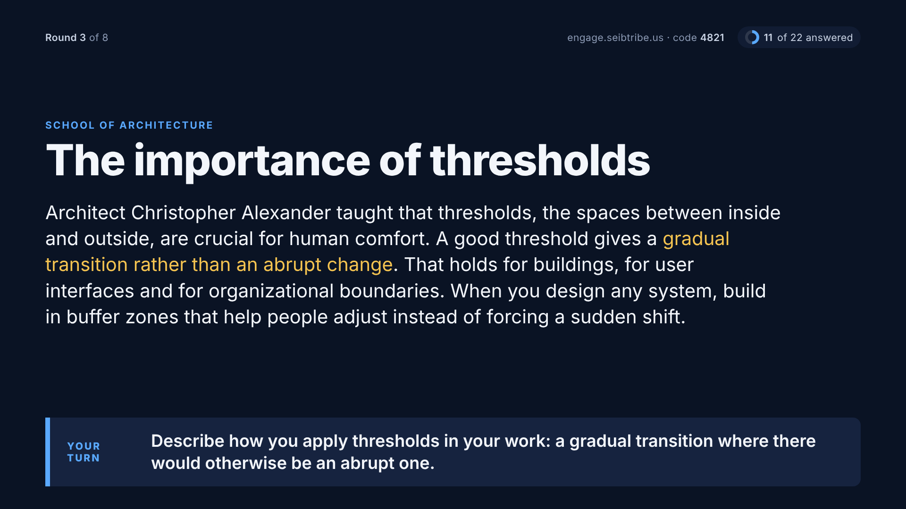
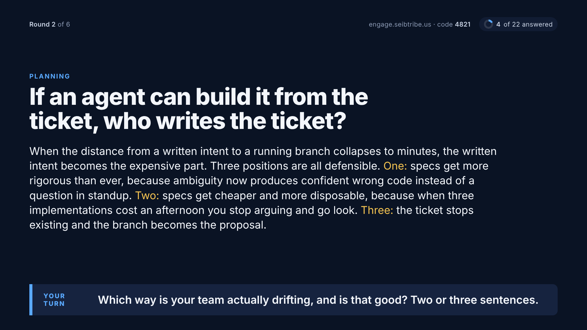
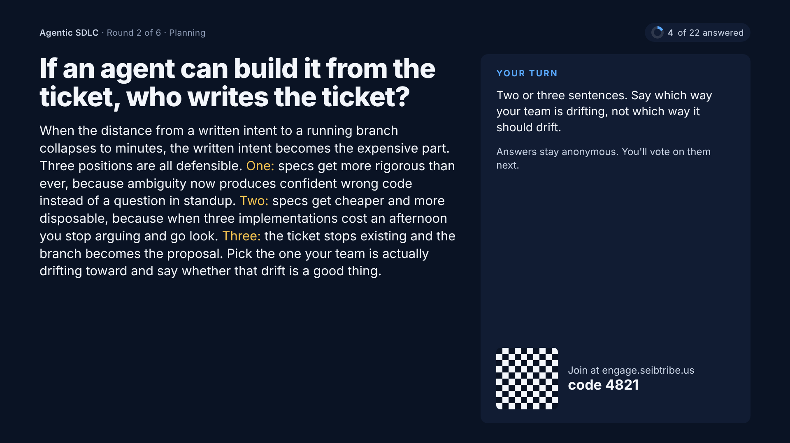
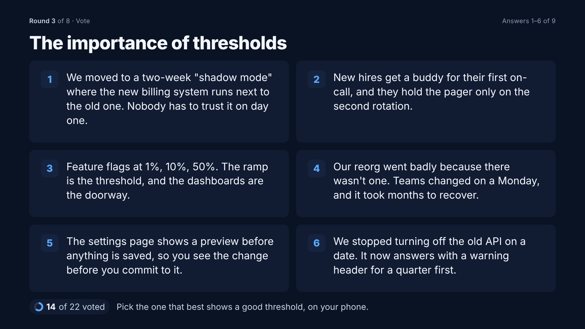
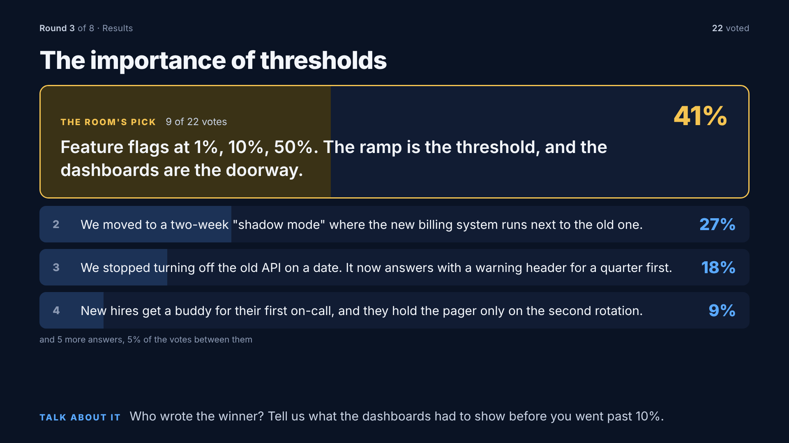
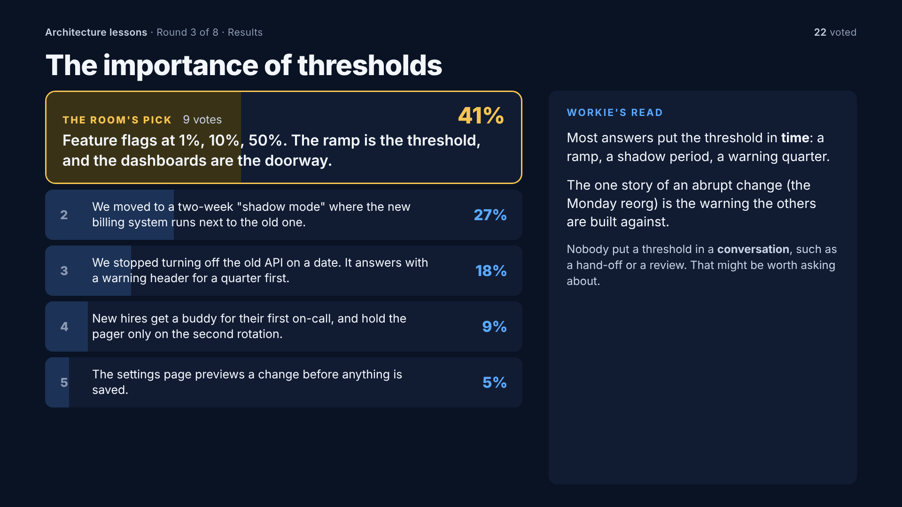
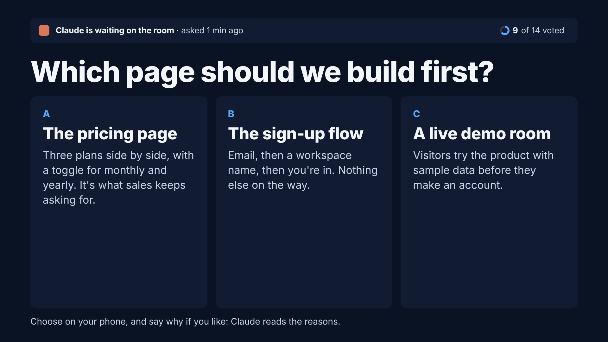
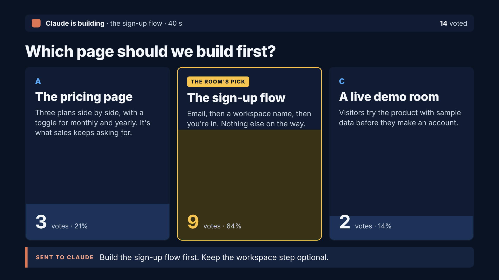

# Room screens, redrawn (mockup, 18 Oct 2026)

These frames replace `docs/design/room-content/`. The owner rejected those on 18 Oct:

> "you provided the biggest text with the generic room instructions, not the changing lesson,
> which in several mockups is not even visable. the instructions is the optional one. the
> title often is nice to have big too."

> "same goes for the results and the voting its nice to see a bar chart results but not at
> the expense of seeing what was voted on. think of what is important to take away and
> discuss. then think how do i make it really visually engaging and informative quickly."

This is a static mockup (`index.html`). **Nothing here is built yet.** `roomContent.js` on dev
still has the rejected rule, where the task leads and the lesson is dropped.

## The hierarchy, from an instructor's seat

Each moment has one job in the room. Whatever does that job is the biggest thing on screen.
Words that are the same in every round (the instructions, where to answer) are the smallest,
or are left out.

| Moment | The room's job | Large | Small or gone |
|---|---|---|---|
| A lesson or question is up | read it and think | **the title** (hero) and **the lesson** (secondary, 40px on Room; never dropped, steps down to 35px before it pages) | the question's *own* instruction goes in one "Your turn" band. A generic instruction ("answer on your phone") is dropped, because the top strip already says where to answer. The category is a small eyebrow. |
| Voting | weigh the answers | **every answer, whole**, numbered so people can name one out loud; the title as a reminder | how many have voted. No tallies while voting, so the first votes don't steer the rest. |
| Results | take away the winner, then talk | **the winning answer in full**, with its share in gold; the runners-up keep their text | the bars are the fill *behind* each answer, so the chart and what was voted on are one thing. "Talk about it" gives the host a way in. The rest collapse into "and 5 more". |
| Build Room ask | weigh the options | **the prompt** and **each option's title and detail** | Claude's status strip stays at the top on every screen (owner, 17 Oct) |
| Build Room result | see the pick and what Claude does next | **the options, with bars rising inside them**; the winner carries the room's best reason | "Sent to Claude" shows the direction the host sent |

**Call** (a Zoom share, read on people's own screens) keeps the same leads and adds more:
the whole lesson, guidance on how to answer, the QR, every answer with its bar, and
Workie's read of the themes.

## Frames (1920×1080, the Room profile's type steps)

| | |
|---|---|
| 1. A lesson is up, Room |  |
| 2. A 597-character lesson with its own instruction, Room |  |
| 3. The same lesson on Call |  |
| 4. Voting, Room |  |
| 5. Results, Room |  |
| 6. Results on Call, with Workie's read |  |
| 7. Build Room Choose while voting, Room |  |
| 8. Build Room result and what Claude gets, Room |  |

## Questions for the owner before it is built

1. **Pulling the question out of the lesson.** In `lessons-call-and-answer-fixed.csv` the
   question is the first sentence of `Detail_lesson` ("Describe how you apply…"), followed by
   the lesson. Frame 1 moves that sentence into "Your turn". Should the app split off the
   first sentence when it ends in "?" or starts with Describe/Share/How, or should the sets
   get a separate question column, as the agentic set has `CustomInstruction`?
2. **Highlighted phrases** (gold in frames 1 to 3). Should the set author mark them, or
   should there be none? Nothing marks them today.
3. **No tallies while voting.** Agreed, or should the host be able to show them live?
4. **"Talk about it" on results.** Is a fixed facilitator line acceptable ("Who wrote the
   winner? Tell us more"), or should Workie write one per round?
5. **The ALL-CAPS titles** in the architecture set read slower at hero size. Show them in
   sentence case on room screens?
