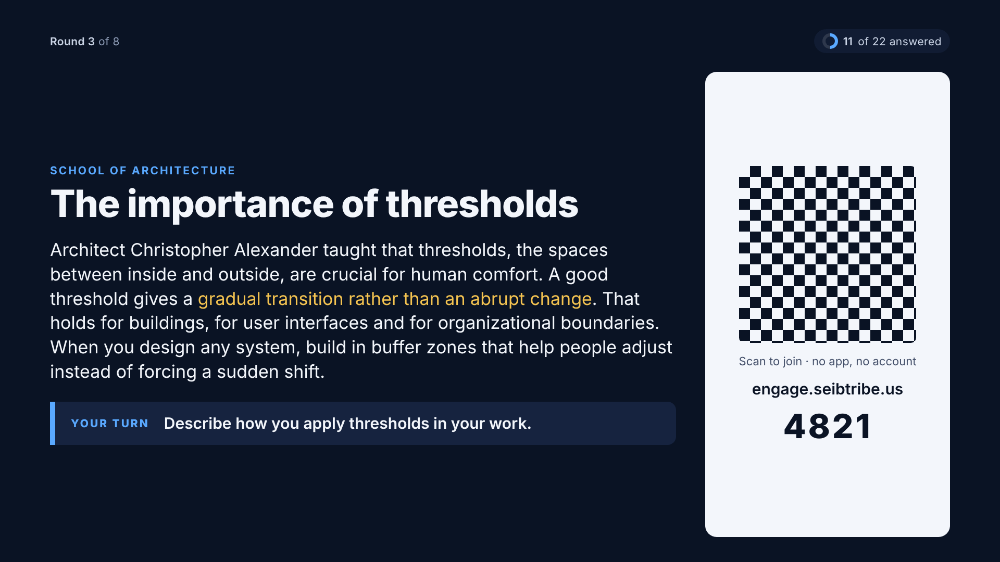
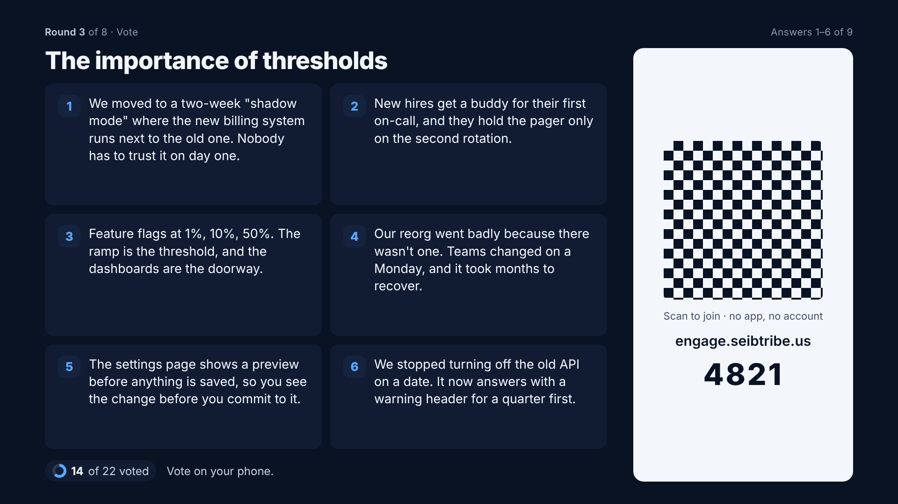
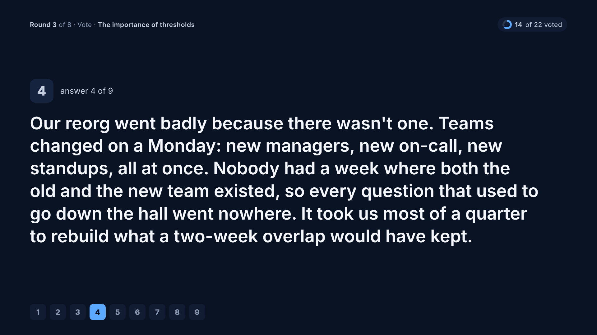
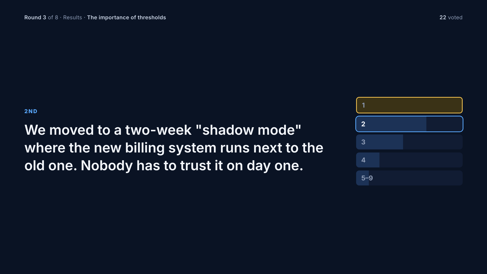

# Room screens, redrawn (mockup, 18 Oct 2026)

These frames replace `docs/design/room-content/`. The owner rejected those on 18 Oct:

> "you provided the biggest text with the generic room instructions, not the changing lesson,
> which in several mockups is not even visable. the instructions is the optional one. the
> title often is nice to have big too."

> "same goes for the results and the voting its nice to see a bar chart results but not at
> the expense of seeing what was voted on. think of what is important to take away and
> discuss. then think how do i make it really visually engaging and informative quickly."

This is a static mockup (`index.html`). **Nothing here is built yet.** Dev is partway there:
`39bd137c` (another session, 18 Oct) already makes the lesson lead on every profile, with the
task under it labelled "The task". This mockup goes further (the title as hero, a "Your turn"
band) and builds on that commit rather than on the 17 Oct rule.

## The hierarchy, from an instructor's seat

Each moment has one job in the room. Whatever does that job is the biggest thing on screen.
Words that are the same in every round (the instructions, where to answer) are the smallest,
or are left out.

| Moment | The room's job | Large | Small or gone |
|---|---|---|---|
| A lesson or question is up | read it and think | **the title** (hero) and **the lesson** (secondary, 40px on Room; never dropped, steps down to 35px before it pages) | the question's *own* instruction goes in one "Your turn" band. A generic instruction ("answer on your phone") is dropped, because the top strip already says where to answer. The category is a small eyebrow. |
| Voting | weigh the answers | **every answer, whole**, numbered so people can name one out loud; the title as a reminder | how many have voted. No tallies while voting, so the first votes don't steer the rest. |
| Results | take away the winner, then talk | **the winning answer in full**, marked as the room's pick; the runners-up keep their text | the bars are the fill *behind* each answer, relative to the winner, so the chart and what was voted on are one thing. **No counts or percentages where names are hidden**: a number beside an answer lets its author be worked out (16 Oct, `presentModel.js`). A named round adds the credit line and points. "Talk about it" gives the host a way in without asking anyone to own up. The rest collapse into "and 5 more". |
| Build Room ask | weigh the options | **the prompt** and **each option's title and detail** | Claude's status strip stays at the top on every screen (owner, 17 Oct) |
| Build Room result | see the pick and what Claude does next | **the options, with bars rising inside them**; the winner carries the room's best reason | "Sent to Claude" shows the direction the host sent |

**Call** (a Zoom share, read on people's own screens) keeps the same leads and adds more:
the whole lesson, guidance on how to answer, the QR, every answer with its bar, and
Workie's read of the themes.

## Two host moves, on every moment (owner, 18 Oct)

> "i like this idea whenever the host wants to show the qr code. it moves the screen around a
> bit so all content is there but the qr code is avail."

> "With the pages that show all responses or results, the host can still choose to click on
> one or the other or cycle through them on the screen. this is especially import when the
> answers are longer."

- **Show the QR** is a panel on the right, not a takeover. The content steps down to fit
  beside it, and nothing leaves the screen. Today `focus: 'join'` replaces the whole moment
  (`present/PresentMoments.jsx`), so this changes it. Press it again to hide the panel.
- **Put one up.** On any page that shows all the answers or results, the host clicks one or
  steps with → and ←, and it fills the screen. The chips (voting) or the ladder (results)
  show where it sits, and Esc goes back to all of them. A long answer splits into parts, as
  `present/presentKeys.js` already does. This reuses the stage-focus `answer` index that
  exists today; the overview is the new part.

## What already exists, and how this fits it

From an inventory of today's room screens and what landed on dev up to 18 Oct.

**Built on, not replaced:**
- **The skins and the shared parts.** The wall draws with `TopLine`, `Eyebrow`, `Heading`,
  `Card`, `TallyRow`, `NumberBadge` and `Pips` on skin roles (`--sk-gold` for the pick, blue
  accent under Present, orange under Classic), and `presentWallPalette.test.js` checks
  contrast in every skin. The mockup's colours are stand-ins: the build uses those roles.
- **The four profiles and the fitter** (shrink to `--fit-min`, drop `data-drop` parts, then
  "and N more"; never scroll). The 35px and 27px steps here are the fitter's job. Each
  frame is checked at 1280×720, 1366×768, 1440×900 and 1920×1080 on Room, TV, Call and
  Table (host standards §5).
- **Stepping through answers**, with parts for long ones (`presentKeys.js`, `presentFit.js`),
  and the one-screen `AnswerSpotlight`. Frames 11 and 12 draw that in the new style.
- **Focus lives on the server** (`stage-focus.js`) and clears on every phase change. Showing
  the QR as a panel, and the overview, each become a fact stored there, not client state.
- **Ideas-first results** (16 Oct, `docs/design/results-ideas-first/`): idea in full, a bar
  relative to the top idea, no podium. Frame 5 is that, larger.
- **Never a name while voting**, never Workie's Background, names with totals only on the
  scoreboard.
- **The lobby** redesign on dev (`b55f6b76`): the title at hero size with the event details,
  and the QR on the right. Kept as is; the QR side panel borrows its block.
- **Claude's status** on every Build Room screen, and **"Sent to Claude" then the work row**
  from `docs/design/build-room-ideas/` (I9, I10). Frame 8's band is that one.
- **Long Build Room asks page** (Room 3 options, TV 2, Call 3, Table 4). On the room's window,
  "and N more options on your phone" covers the rest.
- **Two QR codes in Build Room** (join, and the demo on the Wi-Fi), so its QR panel holds both.

**Kept as they are today, with the same rule applied (the lead is what changes, words that
never change are small):** the trivia reveal (the correct row, the explanation), poll and
wavelength boards, the ask-the-room beat, Workie's read (paged, "Page 2 of 4"), the
feedback beat, the question focus, the scoreboard, the phase wipe, the end screen, and
the Build Room wheel, talking point, run list, idle, Build and History screens.

**Changes to earlier rulings this asks for:**
- The join code: a takeover today, a side panel here.
- Voting opens on answer 1 today (13 Oct); this opens on all the answers when they fit
  (question 5 below).
- Option detail and the room's reasons were Call only (17 Oct); here they show on Room,
  because the room has to see what it is voting on.
- Build Room asks show live counts while voting today; frame 7 hides them until the vote
  closes (question 3).

## Frames (1920×1080, the Room profile's type steps)

| | |
|---|---|
| 1. A lesson is up, Room |  |
| 2. A 597-character lesson with its own instruction, Room |  |
| 3. The same lesson on Call |  |
| 4. Voting, Room |  |
| 5. Results, Room |  |
| 6. Results on Call, with Workie's read |  |
| 7. Build Room Choose while voting, Room |  |
| 8. Build Room result and what Claude gets, Room |  |
| 9. The host shows the QR while a lesson is up |  |
| 10. The QR during voting |  |
| 11. The host puts one answer up while voting |  |
| 12. The host puts one result up |  |

## Questions for the owner before it is built

1. **Pulling the question out of the lesson.** In `lessons-call-and-answer-fixed.csv` the
   question is the first sentence of `Detail_lesson` ("Describe how you apply…"), followed by
   the lesson. Frame 1 moves that sentence into "Your turn". Should the app split off the
   first sentence when it ends in "?" or starts with Describe/Share/How, or should the sets
   get a separate question column, as the agentic set has `CustomInstruction`?
2. **Highlighted phrases** (gold in frames 1 to 3). Should the set author mark them, or
   should there be none? Nothing marks them today.
3. **No tallies while voting.** Agreed, or should the host be able to show them live?
4. **"Talk about it" on results.** Is a fixed facilitator line acceptable ("What do the top
   two have in common?"), or should Workie's discussion topic be used when it has one?
5. **Voting opens on all the answers or on answer 1?** On 2026-10-13 the owner had
   "Response 1 is on the wall from the start of voting" (`presentKeys.js`). These frames open
   on all of them, with → stepping to answer 1. The proposal is to open on the overview
   when they fit on one page, and on answer 1 when they don't.
6. **The ALL-CAPS titles** in the architecture set read slower at hero size. Show them in
   sentence case on room screens?
