# What the room sees, and how large

Owner, 17 Oct 2026:

> "the default option needs to share only the most relevant info to the room. For example
> the call and answer when asked a question or given a lesson the most important thing is
> the lesson [and] the instructions. But anything on the screen worth having needs to be
> large type and readable. This can be more verbose on zoom screen the projector but
> always keep it to just what is needed."

And: "I do like that Claude's status and activity is kept current on the build room stage
(whichever screen shown to the room)."

## The rule

One function decides it for every screen the room sees: `src/src/config/roomContent.js`,
`roomContentFor(moment, profile, data)`. The one-screen stage, the room's window
(`/present`), and the Build Room's Stage, Build and History (one screen and window) all
call it. It names each part of a moment as **lead** (the profile's hero or primary step,
never dropped), **support** (secondary or body step; may give way for space when listed),
**kicker** (small, orienting), **count**, or **dropped**.

- **Room, TV, Table** (a projector, a panel, a table screen): only what is needed.
- **Call** (a Zoom or video share): may also carry the title as a heading, the category,
  the lesson, an ask's detail and the room's reasons.

The full decisions table is in the module's header and in `docs/design/parity/PLAN.md` §2d.
In short:

- **Call & Answer, a question or lesson is up:** the **task** leads. On Room, TV and Table
  the title is a small kicker above it; the lesson shows when the instruction is generic
  and needs it ("How could you adapt this lesson…"); the category goes. Call keeps all of
  it.
- **Build Room, an ask:** the **prompt and the option titles** lead (option titles now at
  the secondary step). Detail, option details and reasons only on Call. A long ask
  **pages**: "Options 1–3 of 6 · page 1 of 2 · ↑ ↓ to page" on the host's Stage; the first
  page and "and 3 more options on your phone" on the room's window.
- **Build Room, Claude's status** (headline, the doing line's duration, the helper and
  activity lines, a run's current step) is on every room screen, every profile, never
  dropped, and never in place of an open ask's prompt.

## Before and after

Pictures at half scale, from the built bundle with fixtures (long tasks, a 300-character
lesson, six options of 130–206 characters).

| | Before | After |
|---|---|---|
| C&A answering, Room, 1920×1080: the title was the hero, the task a 40px line | 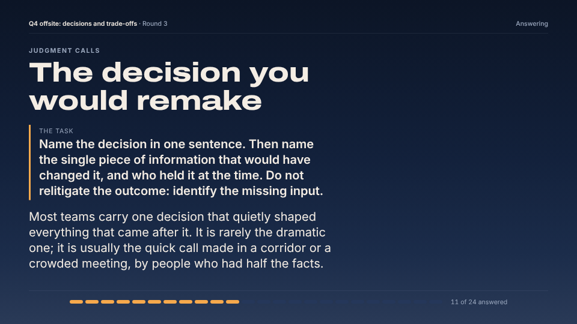 | 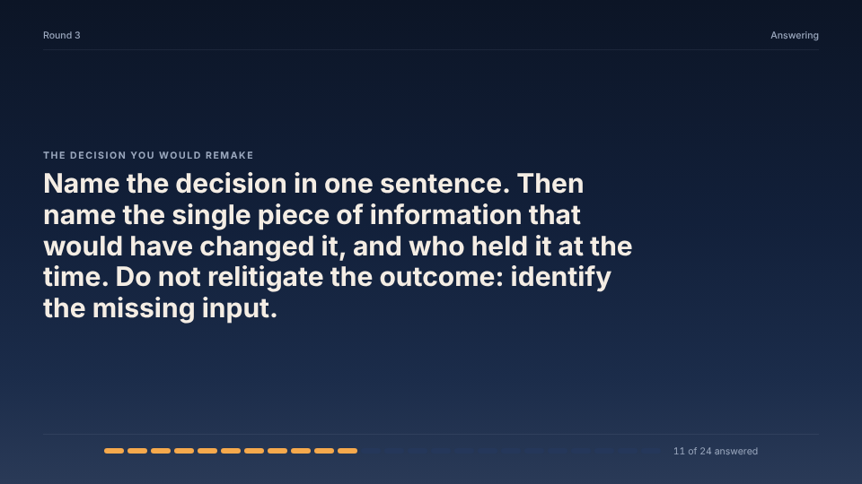 |
| C&A answering, Call, 1920×1080: Call keeps the category, the title and the lesson | 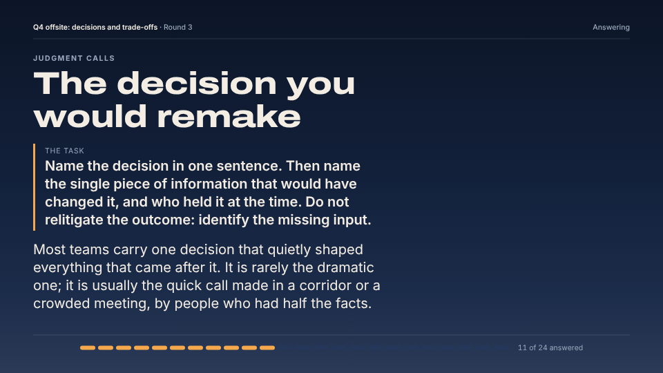 | 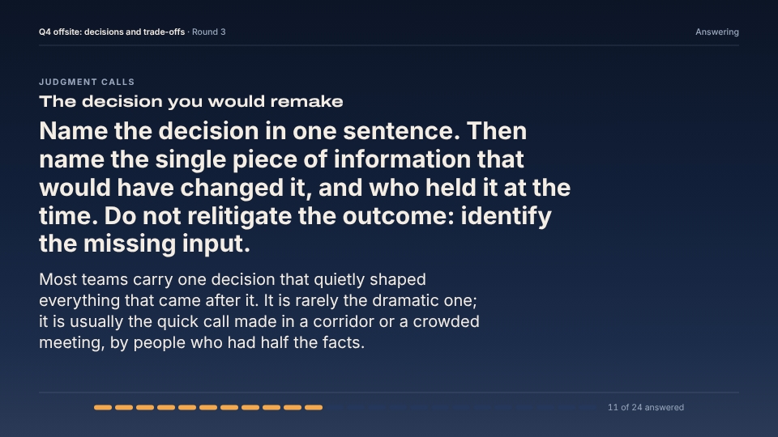 |
| C&A, a lesson with the generic instruction, Room: the lesson stays, under the task | 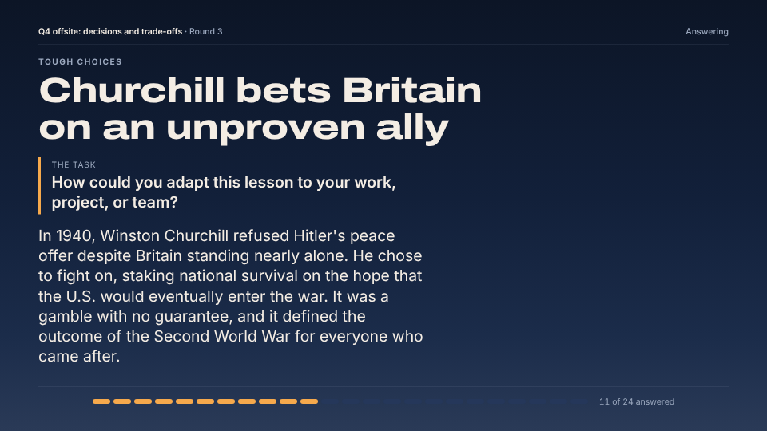 | 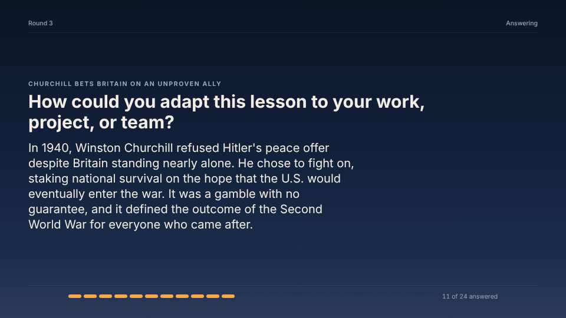 |
| Build Room ask, six long options, Room, 1280×720: E and F ran off the screen | 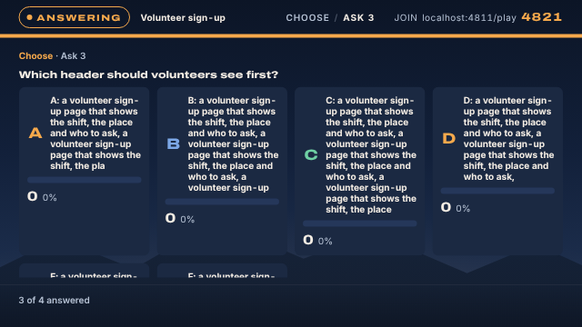 | 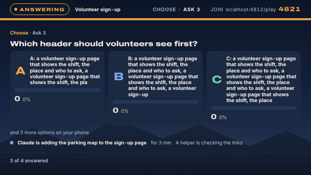 |
| Build Room ask, TV, 1280×720: one option a page under 900px tall | 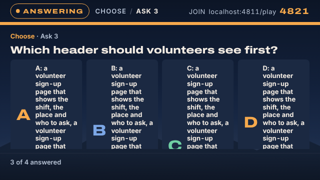 | 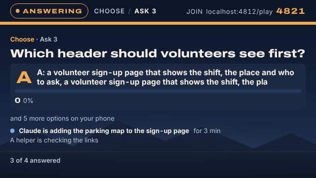 |
| Build Room, Build screen: Claude's status now on it | 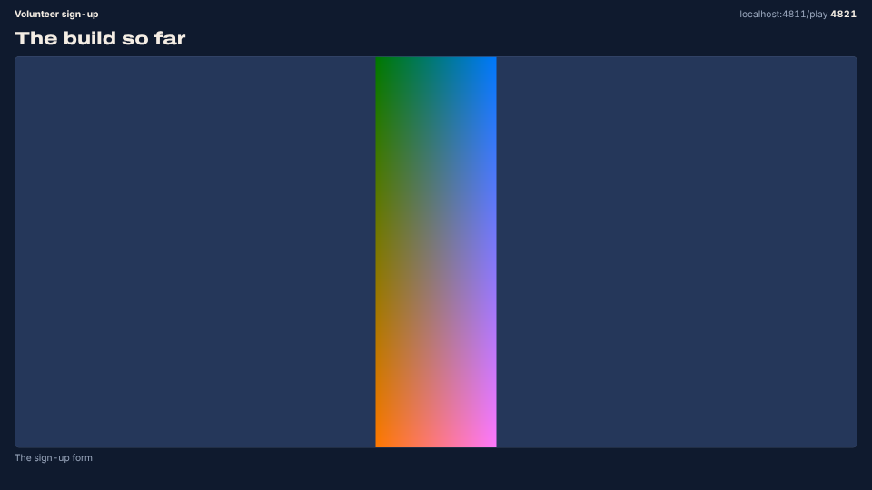 | 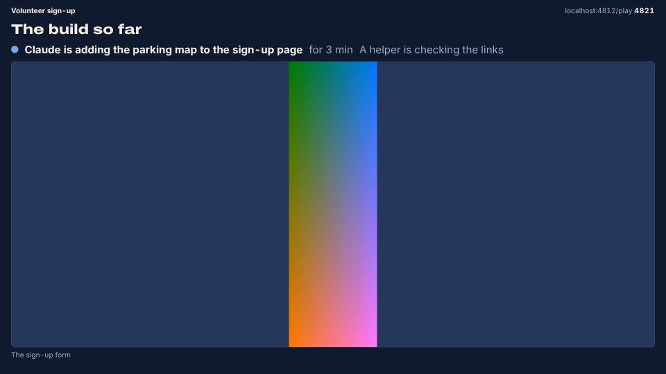 |

## Measured

Chromium against the built bundle, the room's window (C&A and Build Room) with a fake public
API, 1280×720, 1366×768, 1440×900, 1920×1080 × Room, TV, Call, Table, 11 cases: 176 renders.

**The lead's computed size** (the wall's 1920×1080 canvas px; on screen it scales with the
window, so ×0.67 at 1280×720):

| Profile | C&A task while answering, before → after | Build Room prompt on the Stage, 1280×720 → 1920×1080 | Build Room option titles |
|---|---|---|---|
| Room | 40 → **60** (the title was 91) | 30 → 53.5 (before 22.2 → 40.1) | 20.8–35.3 (before 20) |
| TV | 40.6 → **80** | 46.4 → 63.8 (before 41.6 → 62.3) | 31.4–41.4 (before 26–29.5) |
| Call | 40 → **60** | 30 → 53.5 (before 22.2 → 40.1) | 20.2–37.6 (before 20) |
| Table | 28 → **43** | 25.1 → 43.2 (before 17.6 → 41.2) | 17.3–28.1 (before 16–20.6) |

The C&A task never shrank (fit 1) in any render: 60 / 80 / 60 / 43.

| Check | Before | After |
|---|---|---|
| Page or element scrolls | 0 / 176 | 0 / 176 |
| `data-fit="miss"` on the wall | 0 | 0 |
| Long Build Room asks `data-clamped` | 28 / 32 | **0 / 32** |
| Build Room options running off the screen | 26 renders | **0** |
| Any `data-clamped` | 37 | 4 (the idle Stage's tall screenshot in 3, the wheel at 1280×720 TV in 1; Claude's line whole in both) |
| Claude's status on Build Room renders that are not the idle Stage | 0 / 80 | **80 / 80**, headline on screen in every one (the idle Stage leads with it in the other 16) |
| Text below the profile's floor in the room's content | Build Room results: the reasons' letter badges at 12px | none (the reasons are Call-only and read the stage ladder) |

Not measured in a browser: the C&A **one-screen** stage (`GameHostPage` needs a signed-in
host). It draws the same parts from the same call (`__tests__/roomContentRender.test.jsx`)
on the stage's own ladders (`__tests__/roomContentPalette.test.js`); walk it on dev at the
sizes above.

Also found and fixed on the way: the stage fitter measured once a frame after mount and
again on resize, but not when the web fonts arrived, so a fit taken on the fallback font
could leave content over its box without marking it (`hooks/useStageFit.js`).
